# 02 — Information Architecture

How the product is organized: every surface, every route, and the navigation model that connects them.

---

## 1. Three surfaces, one product

Fvas presents three distinct surfaces with different audiences, rendering strategies, and auth models. Keeping them architecturally separate is what prevents the marketing site from being slow and the console from being unindexable.

| Surface | Audience | Auth | Rendering | Route group |
| --- | --- | --- | --- | --- |
| **Marketing** | Prospects, search engines | None | Static / ISR, React Server Components | `app/(marketing)` |
| **Auth** | New and returning users | Public, transitional | Client components, no shell | `app/(auth)` |
| **Console** | Authenticated members of an org | JWT + org context | Client-side, TanStack Query | `app/(console)` |

They share one design system and one component library. A visitor moving from the pricing page into the dashboard should feel no seam.

## 2. Sitemap

```mermaid
graph TD
    R["/"] --> M[Marketing]
    R --> A[Auth]
    R --> C["Console — /dashboard"]

    M --> M1["/features"]
    M --> M2["/use-cases + /use-cases/:slug"]
    M --> M3["/pricing"]
    M --> M4["/docs/*"]
    M --> M5["/faq"]
    M --> M6["/contact"]
    M --> M7["/legal/privacy · /legal/terms · /legal/dpa"]
    M --> M8["/changelog"]

    A --> A1["/login"]
    A --> A2["/register"]
    A --> A3["/forgot-password · /reset-password"]
    A --> A4["/verify-email"]
    A --> A5["/onboarding"]
    A --> A6["/invite/:token"]

    C --> C1["/dashboard — Overview"]
    C --> C2["/dashboard/subjects"]
    C --> C3["/dashboard/enrollments"]
    C --> C4["/dashboard/verifications"]
    C --> C5["/dashboard/analytics"]
    C --> C6["/dashboard/api-keys"]
    C --> C7["/dashboard/logs"]
    C --> C8["/dashboard/playground"]
    C --> C9["/dashboard/settings/*"]
```



## 3. Route table

### 3.1 Marketing — `app/(marketing)`

| Route | Page | Rendering | Purpose |
| --- | --- | --- | --- |
| `/` | Landing | Static | Convert a developer to signup in one scroll |
| `/features` | Features | Static | Depth on capabilities for an evaluating engineer |
| `/use-cases` | Use case index | Static | Route visitors to their own vertical |
| `/use-cases/[slug]` | Use case detail | Static, generated | Fintech, healthcare, logistics, HR-tech |
| `/pricing` | Pricing | Static | Plan comparison + quota calculator + FAQ |
| `/docs` | Docs home | Static | Quickstart is the first thing on the page |
| `/docs/[...slug]` | Docs article | Static (MDX) | Guides, API reference, SDK, webhooks |
| `/faq` | FAQ | Static | Accordion, grouped: Product / Technical / Security / Billing |
| `/contact` | Contact | Static + action | Sales form and support routing |
| `/changelog` | Changelog | Static (MDX) | Signals the product is alive |
| `/legal/privacy` · `/legal/terms` · `/legal/dpa` | Legal | Static | Required for a biometric-data product to be buyable |

**Global marketing nav:** Product ▾ (Features, Use Cases, Playground) · Docs · Pricing · Changelog — with `Sign in` and a primary `Start free` CTA. Sticky, translucent with backdrop blur, gains a hairline border after 24 px of scroll.

**Footer:** four columns (Product / Developers / Company / Legal) + theme toggle + status-page link.

### 3.2 Auth — `app/(auth)`

| Route | Page | Notes |
| --- | --- | --- |
| `/login` | Sign in | Email + password. Honors `?next=` for deep-link returns |
| `/register` | Create account | Inline password strength; creates a personal org |
| `/verify-email` | Verify email | Handles `?token=`; resend with cooldown |
| `/forgot-password` | Request reset | Always returns success — never leaks account existence |
| `/reset-password` | Set new password | Token-gated, single-use |
| `/onboarding` | 3-step wizard | Organization → use case → first API key |
| `/invite/[token]` | Accept invitation | Branded with the inviting org; registers or signs in then joins |

The auth layout is a split screen: form on the left (max-width 400 px), a product-truth panel on the right — a live-looking verification result card, not a stock photo. On mobile the right panel collapses to a single logo lockup.

### 3.3 Console — `app/(console)`

| Route | Page | Primary object |
| --- | --- | --- |
| `/dashboard` | Overview | KPIs, volume chart, recent verifications, quick actions |
| `/dashboard/subjects` | Subjects list | Table, search, filter by status |
| `/dashboard/subjects/[id]` | Subject detail | Profile, template history, verification history, danger zone |
| `/dashboard/subjects/new` | Enroll subject | Camera capture wizard |
| `/dashboard/enrollments` | Enrollments | Every enrollment attempt with quality outcome |
| `/dashboard/verifications` | Verification sessions | The core operational table |
| `/dashboard/verifications/[id]` | Session detail | Full evidence: score, threshold, reason, device, key, timeline |
| `/dashboard/verify` | Test verification | Run a live verification from the browser |
| `/dashboard/analytics` | Analytics | Volume, outcomes, failure reasons, latency, top subjects |
| `/dashboard/api-keys` | API keys | Create, reveal-once, rotate, revoke |
| `/dashboard/logs` | Logs | Tabs: Audit · Authentication · API requests |
| `/dashboard/playground` | API playground | Request builder against the user's own test key |
| `/dashboard/settings` | General | Org name, slug, logo, region |
| `/dashboard/settings/members` | Members | Members, roles, pending invites |
| `/dashboard/settings/security` | Security | Threshold preset, liveness, retention, IP allowlist |
| `/dashboard/settings/webhooks` | Webhooks | Endpoints, events, signing secret, delivery log |
| `/dashboard/settings/billing` | Plan & usage | Quota burn, plan comparison, invoices (read-only at MVP) |
| `/dashboard/settings/profile` | Profile | Name, avatar, password, sessions, 2FA (post-MVP) |

## 4. Navigation model

### Console shell

```
┌─────────────────────────────────────────────────────────────────┐
│ [Fvas ▾ Acme Corp]           ⌘K Search…        [?] [🔔] [avatar] │  56px topbar
├──────────────┬──────────────────────────────────────────────────┤
│              │                                                  │
│ OVERVIEW     │   Page header — title, description, actions       │
│  ⌂ Dashboard │  ──────────────────────────────────────────────   │
│  ▤ Analytics │                                                  │
│              │   Content                                        │
│ IDENTITY     │                                                  │
│  ⚇ Subjects  │                                                  │
│  ⊕ Enroll…   │                                                  │
│  ✓ Verific…  │                                                  │
│              │                                                  │
│ DEVELOPER    │                                                  │
│  ⌘ API Keys  │                                                  │
│  ⌁ Playgr…   │                                                  │
│  ▦ Logs      │                                                  │
│              │                                                  │
│ ─────────    │                                                  │
│  ⚙ Settings  │                                                  │
│  ◐ Theme     │                                                  │
│              │                                                  │
│ [Free plan]  │                                                  │
│ [412/1,000 ] │                                                  │
└──────────────┴──────────────────────────────────────────────────┘
   240px                            fluid, content max-w 1280px
```

**Sidebar** — 240 px, collapsible to 64 px icon rail (persisted in `localStorage`), three labeled groups. Grouping by *job* (Overview / Identity / Developer) rather than by data model is deliberate: Rani the integrator lives in Developer, Sari the compliance officer lives in Identity and Logs, and neither has to scan a flat list of eleven items.

**Org switcher** — top-left combobox with search, member count, plan badge, and `+ Create organization`. Switching org resets all TanStack Query caches keyed by org and navigates to `/dashboard`.

**Command palette (⌘K / Ctrl+K)** — the power-user spine of the console. Groups: Navigate, Actions (Enroll subject, Create API key, Invite member, Run verification), Search (subjects, verification IDs, keys), Preferences (theme, sidebar). Recent items surface first.

**Quota widget** — pinned to the sidebar footer, turns amber at 80% and red at 100%. This is a paid-conversion surface disguised as a utility, and it belongs where the user already looks.

**Mobile (< 768 px)** — sidebar becomes a `Sheet` behind a hamburger; tables collapse into stacked cards; the topbar keeps only search and avatar.

## 5. Content hierarchy per page type

Every console page follows the same skeleton so navigation is muscle memory:

```
PageHeader     ← breadcrumb, h1, one-line description, primary + secondary action
Filters        ← search, faceted filters, date range picker (list pages only)
Content        ← metric row / table / detail panels
Pagination     ← cursor-based, "Showing 1–20", per-page selector
```

Detail pages use a 2-column split at ≥ 1024 px: primary evidence left (⅔), metadata and actions right (⅓); stacked below.

## 6. URL and state conventions

| Concern | Convention | Reason |
| --- | --- | --- |
| Resource IDs | Prefixed ULIDs — `sub_01HQZX…`, `vs_…`, `ak_…`, `org_…` | Self-describing in logs and support tickets; sortable by creation time; no sequential enumeration |
| Filters & pagination | URL search params (`?status=rejected&from=2026-07-01&cursor=…`) | Shareable, back-button correct, survives refresh — a compliance officer sends a colleague a link, not a screenshot |
| Org context | Derived from JWT + a persisted `activeOrgId`, **not** in the URL | Avoids `/org/:slug/...` prefixes on every route; the trade-off is that a shared link opens in the recipient's active org, so cross-org links are resolved by ID on the server |
| Destructive actions | Dialog with typed confirmation for irreversible ones | Deleting a subject destroys biometric templates; a one-click undo is not possible |
| Tabs | `?tab=audit` | Deep-linkable log views |

## 7. Empty-state strategy

Empty states are the most-seen screens in a new account, so they are treated as onboarding, not as an error. Every one has an illustration, a one-line explanation, a primary action, and a secondary link to docs.

| Surface | Empty message | Primary action |
| --- | --- | --- |
| Overview | "No verifications yet — run your first one to see it here" | Run test verification |
| Subjects | "Subjects are the people you verify. Enroll your first." | Enroll subject |
| Verifications | "Verification results will appear here in real time" | Open playground |
| API Keys | "Create a test key to start integrating" | Create test key |
| Logs | "No activity in this range" | Reset filters |
| Members | "Working with a team? Invite them." | Invite member |
| Webhooks | "Get notified the moment a verification completes" | Add endpoint |

Filtered-to-zero is a **different** state from never-had-data, and shows "No results match these filters" with a Clear filters action. Conflating the two is a common and disorienting mistake.

---

**Next:** [03 — User Flows & Wireframes](03-user-flows-wireframes.md)
