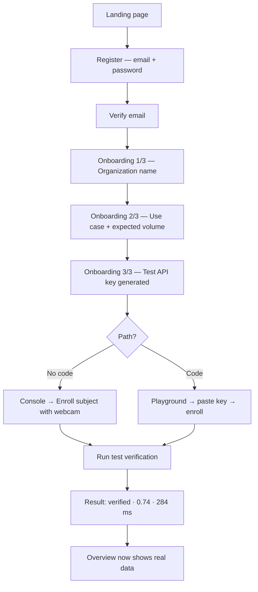
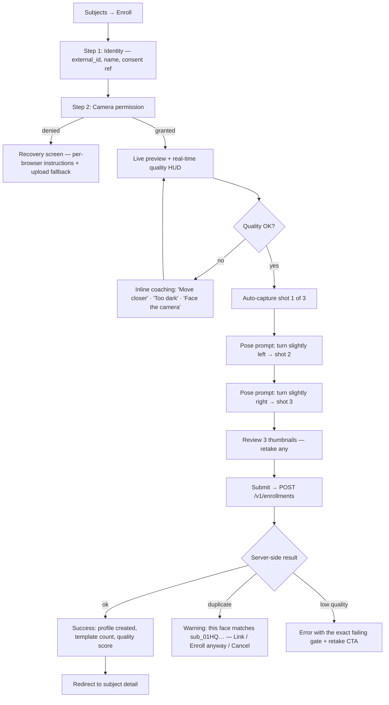
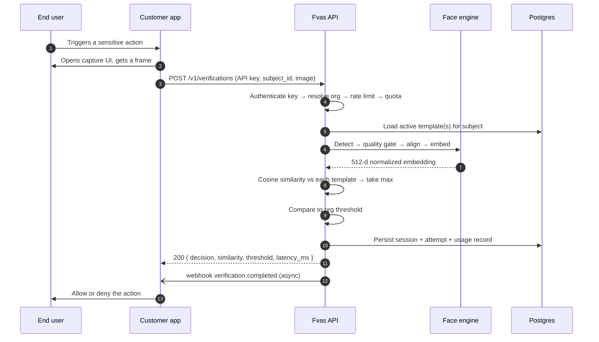
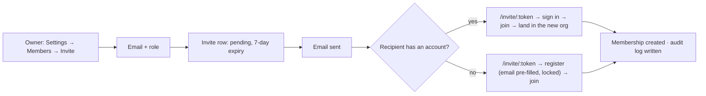
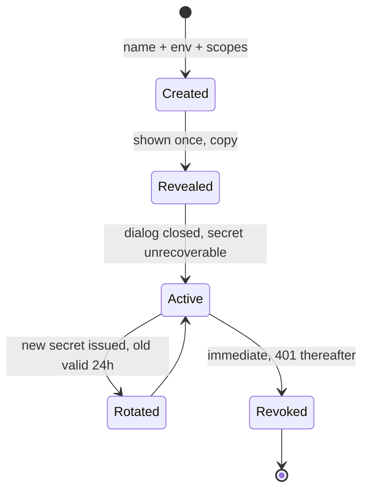

# 03 — User Flows & Wireframe Descriptions

End-to-end flows first, then screen-by-screen layout descriptions detailed enough to build from without a Figma file.

---

## Part A — User flows

### A1. Time to first verification (the flow the product lives or dies on)

Target: **under 10 minutes, unassisted.** Every step below is measured against that budget.



Two paths deliberately converge at the same result screen. Rani (engineer) wants to curl it; Adit (manager) wants to click it. Forcing either into the other's path loses the account.

**Onboarding step 3 is the critical one.** It ends by displaying a working `curl` command, pre-filled with the user's real test key, one click to copy. The user leaves onboarding holding something that works.

### A2. Enrollment (console, camera)



**Design decisions:**

- **Auto-capture, not a shutter button.** The system captures when quality passes, because a user pressing a button looks *at the button*, not at the lens. The manual shutter remains available as an escape hatch.
- **Three shots with pose variation**, not one. Multi-template enrollment measurably reduces false rejection under pose and lighting drift at verification time, at the cost of ~2× enrollment time. Worth it: enrollment happens once, verification happens thousands of times.
- **Quality feedback is live and specific.** "Move closer" beats "invalid image" by a wide margin — the second one makes the user quit.
- **Duplicate detection is a decision point, not a hard block.** Legitimate cases exist (a person re-registering after an account merge). We surface it, log it, and let a human decide — and record which human.

### A3. Verification (API consumer's runtime path)



The customer app never sees the embedding and never needs to store one. That is the whole point of the product.

### A4. Team invitation



The invite token carries the org, the role, and the email. The email field is locked at registration so an invite cannot be redirected to another address.

### A5. API key lifecycle



The 24-hour overlap on rotation exists so a customer can roll a key through a deploy without an outage window. Rotation without overlap is a rotation feature nobody uses.

### A6. Error and recovery paths

| Failure | User sees | Recovery |
| --- | --- | --- |
| Camera permission denied | Illustrated screen with browser-specific steps | Upload an image instead |
| No camera present | Detected on mount; upload mode is the default | — |
| No face detected | Live HUD stays red, "No face detected" | Coaching text, retry is free |
| Multiple faces | "Only one person in frame" | Retry |
| Network error mid-submit | Toast + a Retry button that reuses the captured frame | One tap; captures are not lost |
| Access token expired | Silent refresh, request replayed | Invisible |
| Refresh token expired | Redirect to `/login?next=<current>` with an explanatory toast | Return to the same page after login |
| Quota exceeded (free) | `429` + a full-page banner in console | Upgrade CTA |
| Insufficient role | Action disabled with a tooltip; server returns `403` | "Ask an Owner" with a mailto |

Client-side permission checks disable controls; the server still enforces. The client check is UX, never security.

---

## Part B — Wireframe descriptions

Notation: `▭` block · `▬` row · `◧` split · `→` action. All measurements assume a 1440 px viewport unless stated.

### B1. Landing page `/`

```
┌───────────────────────────────────────────────────────────────┐
│ NAV  Fvas   Product▾ Docs Pricing Changelog    Sign in [Start]│  sticky, blur
├───────────────────────────────────────────────────────────────┤
│                                                               │
│   ▭ Badge  "SOC 2 roadmap · UU PDP ready"                     │
│   H1  Face authentication,                                    │  60px, -2% tracking
│       three API calls away.                                   │  gradient on line 2
│   P   Enroll a face. Verify in 300 ms. Get an audit trail     │  18px, muted
│       your compliance team will actually accept.              │
│   [Start free →] [Read the docs]                              │
│   ▬ trust row: "No card required · 1,000 free verifications"  │
│                                                               │
│   ◧ HERO VISUAL — split card                                  │
│     left: terminal with the POST /v1/verifications request    │
│     right: result card animating in — ✓ verified 0.74 284ms   │
│            with a similarity gauge sweeping to position       │
│                                                               │
├───────────────────────────────────────────────────────────────┤
│ LOGO WALL  "Built for teams that ship" — 5 muted logos        │
├───────────────────────────────────────────────────────────────┤
│ PROBLEM   H2 "Passwords prove possession. Not identity."      │
│   ▭▭▭ three cards: phishable · shareable · no audit trail     │
├───────────────────────────────────────────────────────────────┤
│ HOW IT WORKS  3 numbered steps, connected by a hairline       │
│   1 Enroll   2 Verify   3 Audit                               │
│   each with a code snippet + a one-line outcome               │
├───────────────────────────────────────────────────────────────┤
│ FEATURES  bento grid, 4 cells, asymmetric                     │
│   large: live analytics preview (real chart component)        │
│   tall:  quality gates checklist, animated tick-through       │
│   small: threshold presets   small: webhooks                  │
├───────────────────────────────────────────────────────────────┤
│ DEVELOPER  ◧ left: tabbed code (cURL·Node·Python·Go)          │
│            right: H2 "Integrate in an afternoon" + 4 bullets  │
├───────────────────────────────────────────────────────────────┤
│ SECURITY  ▬ 4 badges: templates-not-photos · AES-256 ·        │
│           hard delete · RBAC + audit                          │
├───────────────────────────────────────────────────────────────┤
│ PRICING TEASER  3 plan cards, Startup highlighted             │
├───────────────────────────────────────────────────────────────┤
│ FAQ  accordion, 6 items                                       │
├───────────────────────────────────────────────────────────────┤
│ CTA  full-bleed gradient panel, single H2 + one button        │
├───────────────────────────────────────────────────────────────┤
│ FOOTER  4 columns · theme toggle · status · social            │
└───────────────────────────────────────────────────────────────┘
```

**Motion:** sections fade + rise 16 px on scroll-into-view, 400 ms, `ease-out`, staggered 60 ms, `once: true`. The hero result card animates on mount only. All of it is suppressed under `prefers-reduced-motion`. The rule: motion explains a relationship or it does not ship.

**Why a real result card instead of a hero screenshot:** the product's value is a decision with evidence. Showing the actual decision object communicates more in two seconds than a dashboard screenshot does in ten, and it costs nothing to keep truthful.

### B2. Pricing `/pricing`

```
▬ H1 "Pricing that tracks your usage, not your headcount"
▬ Toggle: Monthly | Annual (−20%)
▭▭▭▭ Four plan cards; Startup elevated with a "Most popular" ribbon
     each: price · unit · CTA · 6 feature rows with ✓/—
▬ QUOTA CALCULATOR  slider: verifications/month → recommended plan
                    + a live cost readout including overage
▭ COMPARISON TABLE  sticky header row, grouped: Usage · Features ·
                    Security · Support; ✓ / — / value cells
▭ FAQ accordion — billing-specific
▬ Enterprise strip: "Data residency, on-prem, SSO" → Contact sales
```

The calculator exists because usage-based pricing creates purchase anxiety. Let the buyer resolve it themselves rather than making them email sales — the same principle as the rest of the product.

### B3. Console overview `/dashboard`

```
┌ PageHeader ─────────────────────────────────────────────────┐
│ Overview                          [⌄ Last 7 days] [Verify →]│
│ Everything happening in Acme Corp                            │
├ METRIC ROW — 4 cards ───────────────────────────────────────┤
│ ┌──────────┐┌──────────┐┌──────────┐┌──────────┐            │
│ │Verificat.││Success   ││p95       ││Active    │            │
│ │  12,481  ││  97.2%   ││ 284ms    ││ subjects │            │
│ │ ▲ 12.4%  ││ ▲ 0.8pp  ││ ▼ 31ms   ││  1,204   │            │
│ │ sparkline││ sparkline││ sparkline││ ▲ 84     │            │
│ └──────────┘└──────────┘└──────────┘└──────────┘            │
├ ◧ 2/3 + 1/3 ────────────────────────────────────────────────┤
│ ┌ Verification volume ──────────┐ ┌ Quick actions ────────┐ │
│ │ stacked area: verified /      │ │ ⊕ Enroll a subject     │ │
│ │ rejected / inconclusive       │ │ ✓ Run verification     │ │
│ │ hover → date, counts, rate    │ │ ⌘ Create API key       │ │
│ │                               │ │ ⚇ Invite a member      │ │
│ └───────────────────────────────┘ ├ Plan usage ───────────┤ │
│                                   │ Free · 412 / 1,000     │ │
│                                   │ ▓▓▓▓▓░░░░░ 41%         │ │
│                                   │ Resets in 18 days      │ │
│                                   │ [Upgrade]              │ │
│                                   └────────────────────────┘ │
├ RECENT VERIFICATIONS ───────────────────────────────────────┤
│ Time · Subject · Decision · Score · Latency · Key   [View all]│
│ 2m ago  sub_01HQ…  ✓ verified   0.812  241ms  live_9f2c      │
│ 6m ago  sub_01HP…  ✗ rejected   0.213  198ms  live_9f2c      │
│ …8 rows, rows clickable → detail                             │
└──────────────────────────────────────────────────────────────┘
```

**States:** skeleton mirrors this exact layout (4 shimmer cards, a chart-shaped block, 8 shimmer rows) so nothing shifts on load. Empty state replaces the whole body with a centered illustration + "Run your first verification". Error replaces just the failing card, not the page — a broken chart must not take down the metrics.

**Why these four metrics:** volume answers "is it being used", success rate answers "is it working", p95 answers "is it fast enough to keep", active subjects answers "is it growing". They map to the four questions a customer asks before renewing.

### B4. Verifications list `/dashboard/verifications`

```
┌ PageHeader: Verification sessions            [Export CSV] [Verify →]
├ FILTER BAR ─────────────────────────────────────────────────┐
│ [🔍 Search by session or subject ID]                         │
│ [Decision ▾] [API key ▾] [Date range ▾]   3 filters · Clear  │
├ TABLE (TanStack Table) ─────────────────────────────────────┤
│ ▢ │ Session      │ Subject   │ Decision │ Score │ Threshold │
│   │              │           │          │  bar  │           │
│ ▢ │ vs_01HQZX…   │ sub_01HQ… │ ✓ verified│ ▓▓▓░ .81│ 0.38    │
│ ▢ │ vs_01HQZW…   │ sub_01HP… │ ✗ rejected│ ▓░░░ .21│ 0.38    │
│ ▢ │ vs_01HQZV…   │ sub_01HN… │ ⚠ inconcl.│  —     │ 0.38    │
│   … + Latency · Source · Time (relative, absolute on hover)  │
│   row → drawer (Sheet) with full detail, ↑↓ to move between  │
├ ▬ Showing 1–20 · [Rows: 20 ▾] · [← Prev] [Next →]           │
└──────────────────────────────────────────────────────────────┘
```

The score column renders a **mini bar with a threshold tick mark**, not a bare number. A number requires the reader to remember the threshold; a bar with a tick shows margin at a glance. This is the single highest-value visual decision in the console — it turns a log table into an instrument.

Row click opens a right-side `Sheet`, not a page navigation: an operator scanning a hundred rows should not lose their scroll position twenty times.

### B5. Verification detail (Sheet / `/dashboard/verifications/[id]`)

```
┌ Sheet, 560px ───────────────────────────────────────────────┐
│ vs_01HQZX8K…  [copy]                                    [×] │
│ ✓ VERIFIED    2026-07-30 14:22:08 WIB                       │
├─────────────────────────────────────────────────────────────┤
│ SIMILARITY                                                  │
│  0.0        threshold 0.38 ▼                 0.81      1.0  │
│  ├──────────────────┼──────────────────────────●───────┤    │
│  Margin +0.43 above threshold                               │
├─────────────────────────────────────────────────────────────┤
│ Subject      sub_01HQ… (Rani Wulandari)              →      │
│ Templates    3 compared · best match #2                     │
│ Latency      241 ms  (detect 62 · embed 148 · match 31)     │
│ API key      fvas_live_…9f2c  "production-api"       →      │
│ Source IP    103.xx.xx.14 · Jakarta, ID                     │
│ User agent   Chrome 138 / macOS                             │
│ Quality      sharpness 0.86 · brightness 0.71 · yaw −4.2°   │
│ Idem. key    idem_7c1f…                                     │
├─────────────────────────────────────────────────────────────┤
│ TIMELINE                                                    │
│ ● 14:22:08.104  Request received                            │
│ ● 14:22:08.119  Key authenticated · org resolved            │
│ ● 14:22:08.181  Face detected (1)                           │
│ ● 14:22:08.329  Embedding computed                          │
│ ● 14:22:08.345  Matched 3 templates → max 0.812             │
│ ● 14:22:08.351  Decision: verified                          │
│ ● 14:22:08.402  Webhook queued                              │
├─────────────────────────────────────────────────────────────┤
│ [View subject] [Copy as JSON] [Report false accept]          │
└─────────────────────────────────────────────────────────────┘
```

The latency breakdown and timeline are what make this screen credible to an engineer debugging an integration — and they cost nothing, because the pipeline already produces those timestamps. "Report false accept" feeds a labelled dataset for threshold recalibration: a support affordance and a data-collection mechanism in one control.

### B6. Enrollment capture `/dashboard/subjects/new`

```
┌ Stepper: ① Identity ── ② Capture ── ③ Review ───────────────┐
│                                                             │
│            ┌───────────────────────────────┐                │
│            │                               │                │
│            │      ╭───────────────╮        │  video, 4:3    │
│            │      │   oval guide  │        │  mirrored      │
│            │      │   ● face box  │        │  rounded-2xl   │
│            │      ╰───────────────╯        │                │
│            │                               │                │
│            │  ● Good lighting              │  live HUD      │
│            │  ● Face centered              │  green/amber   │
│            │  ○ Move slightly closer       │  /red dots     │
│            └───────────────────────────────┘                │
│                                                             │
│            Hold still — capturing in 2…                     │
│                                                             │
│            ▣ ▣ ▢     shot 2 of 3                            │
│                                                             │
│            [Use upload instead]      [Manual capture]       │
└─────────────────────────────────────────────────────────────┘
```

The oval guide ring changes color with quality state and pulses once at capture. The countdown is 3 s and interruptible. Thumbnails fill left-to-right so progress is spatial, not textual.

**Accessibility:** every quality state is announced through an `aria-live="polite"` region, and the whole flow is completable with the upload fallback for anyone who cannot use the guided capture.

### B7. API keys `/dashboard/api-keys`

```
┌ PageHeader: API keys                            [+ Create key]
│ ⓘ Keys are shown once. Store them in a secret manager.
├ TABS  Live (2) · Test (1) ──────────────────────────────────┤
│ Name          Key              Scopes    Last used   Created │
│ production    fvas_live_…9f2c  full      2m ago      Jul 12  │
│ mobile-app    fvas_live_…3b7a  verify    1h ago      Jul 20  │
│                                              [⋯ Rotate·Revoke]
└──────────────────────────────────────────────────────────────┘

CREATE DIALOG  → name · environment · scopes (enroll/verify/read)
                · optional expiry
REVEAL DIALOG  → ⚠ "This is the only time you'll see this key"
                 [fvas_live_9f2c8a…  copy]  [I've stored it safely]
                 the close button is disabled until copy is clicked
```

Disabling the dismiss until the secret is copied is a small friction that eliminates the most common and most annoying support ticket a developer platform gets.

### B8. Analytics `/dashboard/analytics`

```
▬ Range: [7d] [30d] [90d] [Custom]   Group: [Day ▾]  [Export]
▭ Volume over time — stacked area, brush-selectable
◧ Outcome split (donut, center = total)  |  Failure reasons (h-bar)
◧ Latency distribution (histogram, p50/p95/p99 markers)  |
                                          Top subjects (table)
▭ Success rate by hour of day — heatmap, 7×24
```

The hour-of-day heatmap is the one chart that produces a customer insight nobody asked for: it exposes lighting conditions in physical environments (night-shift rejections spike) and turns a support conversation into a product conversation.

### B9. Playground `/dashboard/playground`

```
◧ LEFT — request builder            │ RIGHT — response
  [POST ▾] /v1/verifications        │  200 OK · 284 ms
  Key: [test_… ▾]                   │  ┌──────────────────┐
  Body (Monaco-lite JSON editor)    │  │ { "decision": …  │
  or [Use camera] to fill `image`   │  │   "similarity": … │
  [Send request]                    │  └──────────────────┘
  ─────────────────────────────     │  [Copy] [as cURL]
  History (last 10, replayable)     │  Headers · Timing
```

The playground runs against the user's real test key and real data. A mocked playground teaches nothing and erodes trust the moment the user notices.

## Part C — State design

Every data-bearing surface implements four states. This is a checklist enforced in code review, not an aspiration.

| State | Rule |
| --- | --- |
| **Loading** | Skeleton matching final layout geometry. No spinner-in-a-void. Optimistic UI for toggles. |
| **Empty** | Illustration + explanation + primary action + docs link. Never a bare "No data". |
| **Error** | What failed, why, what to do next, a Retry button, and a support-quotable request ID. Never a raw stack trace or status code alone. |
| **Success** | Toast for background work; inline confirmation for in-place changes; a full success screen only for multi-step flows. |

**Toast policy:** success 4 s auto-dismiss; error persists until dismissed and carries the action that failed; never toast something the user can already see happen on screen.

---

**Next:** [04 — Design System](04-design-system.md)
