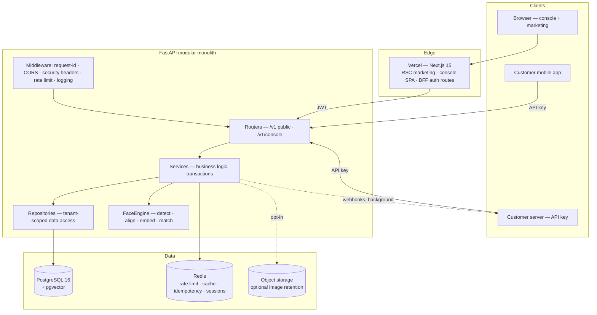

# 05 — Technical Architecture

System design, layering, folder structure, and the reasoning behind each significant decision.

---

## 1. System overview



## 2. Architectural style: modular monolith

One deployable FastAPI application, internally partitioned into domain modules with enforced boundaries.

```
app/modules/
  identity/       users, orgs, memberships, invitations, roles
  auth/           login, tokens, password reset, sessions
  apikeys/        key issuance, hashing, scopes, rotation
  subjects/       tenant end-users
  biometrics/     enrollment, templates, verification, face engine
  analytics/      aggregation, metrics, usage metering
  audit/          audit + auth logs
  webhooks/       endpoints, signing, delivery
  platform/       health, settings, quotas
```

Each module owns `router.py`, `service.py`, `repository.py`, `schemas.py`, `models.py`, `exceptions.py`. **Cross-module access goes through the other module's service, never its repository.** A repository is private to its module. This single rule is what makes a future extraction mechanical rather than archaeological.

**Why not microservices** — at this stage they would buy nothing and cost everything: distributed transactions across enroll/audit/usage, N deployment pipelines, network latency inside a request that must stay under 800 ms, and debugging across process boundaries with a team of one to three. The genuine argument *for* splitting is that the face engine has a different resource profile (CPU-bound, ~400 MB of model weights) than the CRUD API. That is real, and the architecture answers it without a microservice: `FaceEngine` is an interface, and the runtime can move it to a separate process — or a separate service — by swapping the adapter. **Deferred, not designed out.**

**Why not serverless for the API** — model cold-start. Loading SCRFD + ArcFace ONNX weights takes seconds; a cold Lambda would blow the latency budget on the request that matters most. A long-lived container that loads models once at startup is the correct shape for this workload.

## 3. Request lifecycle

```
HTTP request
  │
  ├─ RequestIDMiddleware      attach/propagate X-Request-ID
  ├─ SecurityHeadersMiddleware HSTS, X-Content-Type-Options, frame-ancestors, COOP
  ├─ CORSMiddleware           strict allowlist, credentials on console origin only
  ├─ LoggingMiddleware        structured access log (no PII, no image bytes)
  ├─ RateLimitMiddleware      Redis token bucket by key/IP
  │
  ├─ Dependency: authenticate → Principal (user+org+role | apikey+org+scopes)
  ├─ Dependency: require_permission("verification:create")
  ├─ Dependency: get_db → AsyncSession bound to a TenantContext
  │
  ├─ Router     parse & validate (Pydantic) → call service → serialize response
  ├─ Service    business rules, orchestration, transaction boundary, events
  ├─ Repository tenant-scoped queries only
  │
  └─ ExceptionHandler → uniform error envelope + request ID
```

**The transaction boundary is the service method.** Routers never commit; repositories never commit. One request, one transaction, one place to reason about atomicity.

## 4. Layer responsibilities

| Layer | May do | May never do |
| --- | --- | --- |
| **Router** | Validate input, resolve dependencies, map service results to responses, declare OpenAPI metadata | Contain business rules, touch the ORM, commit |
| **Service** | Orchestrate, enforce rules, own the transaction, emit audit + usage events, call other modules' services | Know about HTTP (`Request`, `HTTPException`, status codes) |
| **Repository** | Build and execute tenant-scoped queries, return entities | Contain business rules, commit, be called across modules |
| **Schema** | Define request/response contracts and validation | Contain persistence concerns |
| **Model** | Define tables, relationships, constraints | Contain business logic beyond trivial derived properties |
| **Core** | Config, security primitives, DB session, exceptions, logging | Import from modules (would create a cycle) |

Services raise **domain exceptions** (`SubjectNotFound`, `QuotaExceeded`, `DuplicateFaceDetected`). A single handler maps them to HTTP. That's what lets the same service run from a CLI, a worker, or a test without an HTTP stack.

## 5. Multi-tenancy

**Shared database, shared schema, `organization_id` on every tenant-owned table.**

| Option | Isolation | Migration cost | Verdict |
| --- | --- | --- | --- |
| Database per tenant | Strongest | N databases to migrate; connection-pool explosion | Enterprise/on-prem only |
| Schema per tenant | Strong | Alembic across N schemas; slow onboarding | Rejected — cost lands immediately, benefit lands later |
| **Shared schema + `organization_id`** | Application-enforced | One migration, instant onboarding | **Chosen** |

The known risk of the chosen option is a forgotten `WHERE organization_id = …`. It is mitigated **structurally**, not by discipline:

1. `TenantScopedRepository` is the only base class for tenant data. Its `_scoped()` helper injects the filter; a query built any other way does not compile past review.
2. Every tenant table has a composite index leading with `organization_id`.
3. An integration test suite creates two organizations and asserts that **every** list and get endpoint returns 404 across the tenant boundary — a generated test, not a hand-written one, so new endpoints are covered by default.
4. **Postgres Row-Level Security** as defense in depth (Phase 8): the app connects as a non-superuser role, and each transaction sets `SET LOCAL app.current_org = …`. Even a bug in step 1 then returns zero rows rather than another tenant's data.

Layer 4 is the one that converts a code-review-dependent guarantee into a database-enforced one. For a biometric product, that is worth the extra complexity.

## 6. Authentication architecture

Two independent auth planes, deliberately never mixed.

### Console plane — human users

```mermaid
sequenceDiagram
    participant B as Browser
    participant N as Next.js BFF
    participant A as FastAPI

    B->>N: POST /api/auth/login
    N->>A: POST /v1/console/auth/login
    A-->>N: access (15m) + refresh (30d)
    N-->>B: Set-Cookie refresh (httpOnly, Secure, SameSite=Lax) + access in body
    Note over B: access token lives in memory only
    B->>A: GET /v1/console/... (Bearer access)
    A-->>B: 401 when expired
    B->>N: POST /api/auth/refresh (cookie sent automatically)
    N->>A: rotate refresh
    A-->>N: new access + new refresh (old one revoked)
    N-->>B: new access; original request replayed
```

**Why the access token is in memory and the refresh token is an httpOnly cookie.** `localStorage` is readable by any script that gets injected, and XSS in a dashboard with API-key management is catastrophic. Cookie-only for both would require CSRF defenses on every mutating endpoint and complicate cross-origin calls to the API host. This split gives XSS-resistance where it matters (the long-lived credential) and simple bearer semantics where it doesn't (a 15-minute token). Cost: a full page reload requires one silent refresh round-trip — a documented, acceptable ~100 ms.

**Refresh rotation with reuse detection**: each refresh issues a new token and revokes the old. A replayed old token revokes the entire family and forces re-login — that turns a stolen refresh token from a persistent compromise into a detectable event.

### Machine plane — API keys

`fvas_live_<32 url-safe chars>`. Stored as SHA-256 of the full secret, plus `prefix` and `last4` for display. Lookup is by prefix (indexed), then a constant-time hash comparison.

**Why SHA-256 and not bcrypt/argon2** — this hash is verified on the hot path of every verification request. Argon2 at sane parameters costs 50–100 ms; that is an eighth of the entire latency budget, on every call. The threat model differs from passwords: a 32-character random secret has no dictionary to attack, so the slow-hash property protects against nothing here. SHA-256 of high-entropy input is the correct tool. **Passwords use Argon2id** — different input entropy, different tool.

**Why not JWTs for machines** — JWTs can't be revoked without a lookup, which erases their only advantage. Customers expect to click "revoke" and have it be instant.

## 7. The face engine

The single most important abstraction in the codebase:

```python
class FaceEngine(Protocol):
    def detect(self, image: NDArray) -> list[DetectedFace]: ...
    def assess_quality(self, face: DetectedFace) -> QualityReport: ...
    def align(self, image: NDArray, face: DetectedFace) -> NDArray: ...
    def embed(self, aligned: NDArray) -> Embedding: ...      # L2-normalized, 512-d
    def compare(self, a: Embedding, b: Embedding) -> float:  # cosine, [-1, 1]
```

Three implementations, one interface:

| Implementation | Use |
| --- | --- |
| `InsightFaceEngine` | Production — SCRFD-10GF + ArcFace `w600k_r50` on ONNX Runtime |
| `FakeFaceEngine` | Tests and CI — deterministic embeddings from an image hash; no model download, tests run in milliseconds |
| `RemoteFaceEngine` | Future — HTTP/gRPC to a dedicated inference service |

This is what makes the CI pipeline fast and the future extraction cheap. It is also what makes the model-licensing risk in the [PRD](01-prd.md#8-known-risks--honest-limitations) survivable: swapping to a commercially licensed model is one adapter.

**Concurrency.** ONNX inference is CPU-bound and holds the GIL for the duration. Calling it directly in an `async def` handler would stall the event loop for every concurrent request. Mitigations, in order of preference:

1. Run inference in a bounded thread pool (`anyio.to_thread`) — ONNX Runtime releases the GIL inside its native kernels, so this gives real parallelism.
2. Cap ORT to `intra_op_num_threads = 2` and run N Uvicorn workers, rather than one worker with all cores. Predictable per-request latency beats peak throughput for an auth API.
3. Load models **once at startup** via the lifespan hook. A lazy first-request load would give the first user of every deploy a 5-second verification.

## 8. Frontend architecture

### Rendering strategy per surface

| Surface | Strategy | Why |
| --- | --- | --- |
| Marketing | React Server Components, statically rendered | SEO, LCP, zero JS for most of the page |
| Docs | RSC + MDX at build time | Same, plus content lives in git |
| Auth | Client components | Interactive forms, no SEO value |
| Console | Client components + TanStack Query | Fully authenticated, highly interactive, no SEO value; server-rendering it would mean forwarding tokens server-side for zero benefit |

**Why not fetch console data in Server Components.** RSC data fetching would require the Next server to hold the user's access token, turning a static host into a stateful auth proxy and adding a hop to every request. Instead the browser calls FastAPI directly with a short-lived bearer token, and Next serves as a **BFF for the auth endpoints only** — the narrow set that must touch the httpOnly refresh cookie. Minimum server surface, maximum clarity about where credentials live.

### State ownership

| State | Owner | Rule |
| --- | --- | --- |
| Server data | **TanStack Query** | Every remote read. Query keys are `[resource, orgId, params]` so an org switch invalidates cleanly |
| URL state | **`nuqs` / searchParams** | Filters, pagination, tabs, date ranges — shareable and back-button correct |
| Ephemeral UI | **Zustand** | Sidebar collapse, command palette, capture-wizard progress |
| Form state | **React Hook Form + Zod** | Uncontrolled inputs, one schema shared with the API contract |
| Theme | **next-themes** | Class strategy, no flash |

Zustand holds no server data. The most common failure mode in React dashboards is a global store shadowing the cache and drifting out of sync; the boundary above prevents it by definition.

### Type safety across the boundary

`openapi-typescript` generates TS types from FastAPI's OpenAPI schema into `packages/shared`. A CI job regenerates and fails on drift. **The backend schema is the single source of truth** — a backend field rename becomes a frontend compile error instead of a runtime `undefined`.

## 9. Folder structure

### `apps/api`

```
apps/api/
├── app/
│   ├── main.py                  # app factory, lifespan, router mounting
│   ├── core/
│   │   ├── config.py            # pydantic-settings, env-typed
│   │   ├── database.py          # async engine, session factory, Base
│   │   ├── security.py          # argon2, JWT encode/decode, key hashing
│   │   ├── exceptions.py        # domain exception hierarchy + handlers
│   │   ├── logging.py           # structlog JSON config
│   │   ├── pagination.py        # cursor helpers
│   │   └── redis.py
│   ├── middleware/
│   │   ├── request_id.py  rate_limit.py  security_headers.py  logging.py
│   ├── dependencies/
│   │   ├── auth.py              # get_current_user, get_api_key_principal
│   │   ├── permissions.py       # require_permission(...)
│   │   ├── db.py                # get_db bound to TenantContext
│   │   └── pagination.py
│   ├── modules/
│   │   ├── identity/  auth/  apikeys/  subjects/
│   │   ├── biometrics/
│   │   │   ├── router.py service.py repository.py schemas.py models.py
│   │   │   └── engine/
│   │   │       ├── base.py       # FaceEngine protocol + value objects
│   │   │       ├── insightface.py
│   │   │       ├── fake.py
│   │   │       ├── quality.py    # blur, brightness, pose, size gates
│   │   │       └── matcher.py    # cosine, threshold policy
│   │   ├── analytics/  audit/  webhooks/  platform/
│   ├── shared/
│   │   ├── base_repository.py   # TenantScopedRepository
│   │   ├── base_model.py        # ULID pk, timestamps, soft delete
│   │   ├── events.py            # in-process event bus (audit, usage, webhooks)
│   │   └── utils/               # ulid, images, time, validators
│   └── workers/
│       └── webhook_dispatcher.py
├── alembic/versions/
├── tests/{unit,integration,e2e,factories,conftest.py}
├── pyproject.toml
└── Dockerfile
```

### `apps/web`

```
apps/web/
├── src/
│   ├── app/
│   │   ├── (marketing)/{page,features,pricing,use-cases,docs,faq,contact,legal}
│   │   ├── (auth)/{login,register,forgot-password,reset-password,onboarding,invite}
│   │   ├── (console)/dashboard/{page,subjects,enrollments,verifications,
│   │   │                        analytics,api-keys,logs,playground,settings}
│   │   ├── api/auth/{login,refresh,logout}/route.ts   # BFF — cookies only
│   │   ├── layout.tsx  globals.css  error.tsx  not-found.tsx
│   ├── components/
│   │   ├── ui/            # shadcn primitives
│   │   ├── shared/        # PageHeader, DataTable, EmptyState, CopyButton…
│   │   ├── marketing/     # Hero, BentoGrid, PricingTable, FaqAccordion…
│   │   ├── console/       # Sidebar, Topbar, OrgSwitcher, CommandPalette…
│   │   └── biometrics/    # CameraCapture, FaceQualityHUD, SimilarityBar…
│   ├── features/          # vertical slices: api/, hooks/, schemas/, components/
│   │   ├── auth/  subjects/  enrollments/  verifications/  api-keys/  analytics/
│   ├── lib/
│   │   ├── api-client.ts  # fetch wrapper: auth, refresh-on-401, error mapping
│   │   ├── query-client.ts  utils.ts  constants.ts  format.ts
│   ├── hooks/  stores/  types/  config/
├── public/
├── next.config.ts  tailwind.config.ts  components.json
└── Dockerfile
```

Components are grouped by **domain**, and data logic by **feature slice**. A flat `components/` folder stops scaling at roughly forty files; by then nobody can tell which are reusable.

## 10. Cross-cutting concerns

**Errors** — one envelope, everywhere:

```json
{
  "error": {
    "code": "quality_check_failed",
    "message": "Face is too small in the frame.",
    "details": { "check": "min_face_size", "value": 78, "required": 112 },
    "request_id": "req_01HQZX8K4M2N"
  }
}
```

`code` is stable and machine-readable; `message` is human and may change; `details` are structured; `request_id` appears in the response header, the logs, and the support ticket.

**Logging** — `structlog` JSON with `request_id`, `org_id`, `principal`, `route`, `status`, `duration_ms`. **Never** image bytes, embeddings, tokens, or key secrets. A log-redaction unit test asserts this on the sensitive-field list.

**Configuration** — `pydantic-settings`, fully typed, fails fast at startup on a missing or malformed variable. A misconfigured deploy should crash immediately, not serve broken requests.

**Events** — an in-process synchronous event bus emits `verification.completed`, `enrollment.completed`, `audit.*`. Audit writes and usage metering subscribe. Trade-off: synchronous handlers add latency to the request. Accepted because audit durability matters more than 5 ms, and the seam is exactly where a queue drops in later.

**Background work** — FastAPI `BackgroundTasks` for webhook delivery at MVP, with retries and exponential backoff persisted in `webhook_deliveries`. No broker, per the no-overengineering constraint. Known limit: a process restart loses in-flight deliveries, so a periodic sweep re-queues rows stuck in `pending`. Migration path is `arq` (Redis-backed) — Redis is already a dependency.

## 11. Decision log

| # | Decision | Alternatives rejected | Trade-off accepted |
| --- | --- | --- | --- |
| 1 | Modular monolith | Microservices, serverless | Scales as one unit; module boundaries keep extraction cheap |
| 2 | FastAPI + async SQLAlchemy 2.0 | Django REST, Flask, Node | Smaller ecosystem of batteries than Django; gained native OpenAPI, Pydantic v2 validation, and Python-native ML libraries in-process |
| 3 | PostgreSQL + pgvector | Dedicated vector DB (Pinecone, Qdrant) | Slower at 10M+ vectors; avoided a second datastore, a second consistency model, and dual-write bugs at 1:1 workloads where ANN is unnecessary |
| 4 | Shared-schema tenancy | DB/schema per tenant | Requires disciplined scoping; mitigated with a base repository, generated isolation tests, and RLS |
| 5 | Memory access token + httpOnly refresh | localStorage, cookie-only | One extra refresh hop on reload; removes the XSS token-theft path |
| 6 | SHA-256 for API keys, Argon2id for passwords | Argon2 everywhere | None — matched to input entropy and hot-path latency |
| 7 | `FaceEngine` protocol with a fake | Direct InsightFace calls | Small indirection; buys fast CI, testability, and a model-swap path |
| 8 | Next.js BFF for auth only | Full BFF, no BFF | Two auth paths to reason about; minimizes stateful server surface |
| 9 | TanStack Query owns server state | Redux, SWR, RSC fetching | Another library; eliminates the cache/store drift class of bugs |
| 10 | shadcn/ui copied in | MUI, Mantine, Chakra | We own the code and its updates; total control over a design system that must feel bespoke |
| 11 | In-process event bus | Message broker | Adds request latency; no broker to operate, and the seam is pre-built |
| 12 | Cursor pagination | Offset | No random page access; stable under concurrent inserts, which a verification log always has |
| 13 | Monorepo, npm workspaces | Polyrepo, Turborepo/Nx | Manual pipeline wiring; one PR can change contract + producer + consumer atomically |

---

**Next:** [06 — Database Design](06-database.md)
