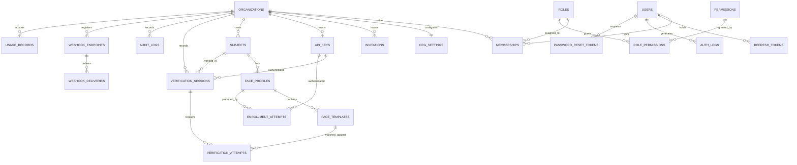

# 06 — Database Design

PostgreSQL 16 + pgvector. Every table, every relationship, and the reasoning behind the modelling choices.

---

## 1. Conventions

| Concern | Convention | Reason |
| --- | --- | --- |
| Primary key | `TEXT` holding a prefixed ULID — `sub_01HQZX8K4M2N…` | Sortable by creation time (unlike UUIDv4), no index fragmentation, self-describing in logs, non-enumerable. Cost: 30 bytes vs 16 for a native UUID — accepted for the operability win |
| Tenant key | `organization_id` on every tenant-owned table, `NOT NULL`, indexed first in every composite index | Enforced isolation and index-friendly access patterns |
| Timestamps | `created_at`, `updated_at` — `TIMESTAMPTZ NOT NULL DEFAULT now()` | Always store UTC with zone; convert at the edge |
| Soft delete | `deleted_at TIMESTAMPTZ NULL` on business entities only | Recoverability and audit. **Biometric templates are exempt** — deletion there is physical (see §4) |
| Enums | Postgres `ENUM` for closed sets, `TEXT` + check for evolving ones | Type safety where the set is genuinely closed |
| Money / counts | `BIGINT` for counters, `NUMERIC(12,4)` for money | Never floats for money |
| Naming | `snake_case`, plural tables, singular columns, `fk_`/`ix_`/`uq_` prefixes on constraints | Predictable, greppable |
| Migrations | Alembic, one revision per PR, always reversible, never edited after merge | |

## 2. Entity-relationship diagram



## 3. The modelling decision that matters most

**`users` and `subjects` are different things and must never be the same table.**

| | `users` | `subjects` |
| --- | --- | --- |
| Who | People who log into the Fvas console | The customer's end-users whose faces are enrolled |
| Auth | Email + password, JWT | None — they never touch Fvas |
| Scale | Tens per organization | Millions per organization |
| Identity | Email (global) | `external_id` (unique per organization) |
| Data | Profile, role, sessions | Biometric templates, verification history |
| Lifecycle | Invited, may leave | Created by API, deleted on the customer's instruction |

Merging them is the most common structural error in student implementations of this product, and it makes GDPR/UU PDP deletion, tenancy, and scale all wrong at once. Rani the engineer is a `user`; the borrower whose face is verified is a `subject`.

## 4. Tables

### 4.1 Identity & tenancy

**`organizations`** — the tenant boundary.

| Column | Type | Notes |
| --- | --- | --- |
| `id` | `TEXT` PK | `org_…` |
| `name` | `TEXT NOT NULL` | |
| `slug` | `TEXT NOT NULL UNIQUE` | URL-safe, immutable after creation |
| `plan` | `plan_enum NOT NULL DEFAULT 'free'` | `free · startup · growth · enterprise` |
| `region` | `TEXT NOT NULL DEFAULT 'ap-southeast'` | Data-residency marker; enforced at deploy, recorded here |
| `logo_url`, `billing_email` | `TEXT NULL` | |
| `created_at`, `updated_at`, `deleted_at` | `TIMESTAMPTZ` | |

**`org_settings`** — 1:1, split out because it changes on a different cadence and is read on the verification hot path.

| Column | Type | Notes |
| --- | --- | --- |
| `organization_id` | `TEXT` PK/FK | |
| `match_threshold` | `NUMERIC(4,3) NOT NULL DEFAULT 0.380` | Cosine threshold |
| `threshold_preset` | `TEXT NOT NULL DEFAULT 'balanced'` | `lenient · balanced · strict · custom` |
| `min_face_size_px` | `INT NOT NULL DEFAULT 112` | Inter-ocular minimum |
| `require_liveness` | `BOOLEAN NOT NULL DEFAULT false` | Active challenge |
| `max_templates_per_profile` | `INT NOT NULL DEFAULT 5` | |
| `store_raw_images` | `BOOLEAN NOT NULL DEFAULT false` | Opt-in only |
| `image_retention_days` | `INT NOT NULL DEFAULT 0` | |
| `log_retention_days` | `INT NOT NULL DEFAULT 30` | Plan-derived |
| `duplicate_check_enabled` | `BOOLEAN NOT NULL DEFAULT true` | |
| `duplicate_threshold` | `NUMERIC(4,3) NOT NULL DEFAULT 0.600` | Higher than match — a dedup false positive is more damaging |
| `ip_allowlist` | `TEXT[] NULL` | CIDR list for live keys |
| `webhook_signing_secret` | `TEXT NULL` | |

**`users`** — console accounts, global (not tenant-scoped).

| Column | Type | Notes |
| --- | --- | --- |
| `id` | `TEXT` PK | `usr_…` |
| `email` | `CITEXT NOT NULL UNIQUE` | Case-insensitive — prevents duplicate-signup by case |
| `password_hash` | `TEXT NOT NULL` | Argon2id |
| `full_name`, `avatar_url` | `TEXT` | |
| `email_verified_at` | `TIMESTAMPTZ NULL` | |
| `last_login_at` | `TIMESTAMPTZ NULL` | |
| `failed_login_count` | `INT NOT NULL DEFAULT 0` | |
| `locked_until` | `TIMESTAMPTZ NULL` | Progressive lockout |
| `is_active` | `BOOLEAN NOT NULL DEFAULT true` | |

**`memberships`** — the many-to-many that makes multi-org work.

| Column | Type | Notes |
| --- | --- | --- |
| `id` | `TEXT` PK | `mem_…` |
| `organization_id` | `TEXT` FK → `organizations` `ON DELETE CASCADE` | |
| `user_id` | `TEXT` FK → `users` `ON DELETE CASCADE` | |
| `role_id` | `TEXT` FK → `roles` | |
| `status` | `TEXT NOT NULL DEFAULT 'active'` | `active · suspended` |
| `joined_at` | `TIMESTAMPTZ` | |
| | `UNIQUE (organization_id, user_id)` | One membership per user per org |

> **Invariant enforced in the service layer:** an organization always has ≥ 1 active Owner. The last Owner cannot be demoted, removed, or suspended. Expressing this as a database constraint would need a trigger with a partial count; the rule is centralized in `MembershipService` and covered by a dedicated test.

**`invitations`** — `id`, `organization_id`, `email` (citext), `role_id`, `token_hash`, `invited_by_user_id`, `status` (`pending · accepted · revoked · expired`), `expires_at`, `accepted_at`. Unique partial index on `(organization_id, email) WHERE status = 'pending'` — one live invite per email per org.

**`roles`** and **`permissions`** and **`role_permissions`**

Roles are seeded system roles at MVP: `owner`, `admin`, `developer`, `viewer` (with `is_system = true`, `organization_id NULL`). Permissions are `resource:action` strings — `subject:read`, `apikey:create`, `member:invite`, `settings:update`.

> **Trade-off:** the permission check itself resolves from an **in-code matrix**, not a per-request join, and the tables exist to make custom roles a data change rather than a schema change later. A DB round-trip on every authorization check for four fixed roles would be pure cost. The tables are seeded via migration and kept as the source of truth for the UI's permission matrix; a startup assertion verifies the code matrix and the seeded rows agree, so they cannot silently diverge. `organization_id` is nullable on `roles` so tenant-defined custom roles slot in without a migration.

**`refresh_tokens`** — `id`, `user_id`, `token_hash`, `family_id`, `expires_at`, `revoked_at`, `replaced_by_id`, `user_agent`, `ip_address`. The `family_id` is what enables reuse detection: presenting a revoked token revokes the whole family.

**`password_reset_tokens`** — `id`, `user_id`, `token_hash`, `expires_at` (30 min), `used_at`. Single-use.

### 4.2 Developer surface

**`api_keys`**

| Column | Type | Notes |
| --- | --- | --- |
| `id` | `TEXT` PK | `ak_…` |
| `organization_id` | `TEXT` FK | |
| `name` | `TEXT NOT NULL` | Human label |
| `environment` | `TEXT NOT NULL` | `test · live` |
| `key_prefix` | `TEXT NOT NULL` | e.g. `fvas_live_9f2c` — indexed lookup |
| `key_hash` | `TEXT NOT NULL` | SHA-256 of the full secret |
| `last4` | `TEXT NOT NULL` | Display only |
| `scopes` | `TEXT[] NOT NULL` | `enrollment:write`, `verification:write`, `subject:read`… |
| `created_by_user_id` | `TEXT` FK | |
| `last_used_at` | `TIMESTAMPTZ NULL` | Updated at most once/minute (see §6) |
| `expires_at`, `revoked_at` | `TIMESTAMPTZ NULL` | |
| | `UNIQUE (key_prefix)`, `INDEX (organization_id, environment)` | |

### 4.3 Biometrics — the core

**`subjects`** — the customer's end-user.

| Column | Type | Notes |
| --- | --- | --- |
| `id` | `TEXT` PK | `sub_…` |
| `organization_id` | `TEXT` FK | |
| `external_id` | `TEXT NOT NULL` | The customer's own user ID |
| `display_name` | `TEXT NULL` | Optional; many customers send nothing |
| `metadata` | `JSONB NOT NULL DEFAULT '{}'` | Customer-defined, size-capped at 8 KB |
| `status` | `subject_status NOT NULL DEFAULT 'pending'` | `pending · enrolled · suspended` |
| `consent_reference` | `TEXT NULL` | The customer's proof-of-consent record ID |
| `consent_at` | `TIMESTAMPTZ NULL` | |
| `enrolled_at`, `last_verified_at` | `TIMESTAMPTZ NULL` | |
| `verification_count` | `BIGINT NOT NULL DEFAULT 0` | Denormalized counter |
| | `UNIQUE (organization_id, external_id) WHERE deleted_at IS NULL`, `INDEX (organization_id, status, created_at DESC)` | |

The uniqueness is **partial**. Deleting a subject destroys its templates but
tombstones the row for audit continuity (see [security §5](09-security.md)), and
a plain unique index would then poison the customer's `external_id` forever —
re-onboarding the same person would collide with their own tombstone, and their
identifier is not something they can change. Scoping uniqueness to live rows is
what the constraint always meant.

`metadata` is `JSONB` rather than typed columns because the shape is the customer's, not ours. A GIN index is added only if filtering demand appears — indexing speculatively costs write throughput on the highest-volume table.

**`face_profiles`** — a versioned enrollment.

| Column | Type | Notes |
| --- | --- | --- |
| `id` | `TEXT` PK | `fp_…` |
| `organization_id`, `subject_id` | `TEXT` FK | |
| `status` | `TEXT NOT NULL DEFAULT 'active'` | `active · superseded · revoked` |
| `version` | `INT NOT NULL DEFAULT 1` | Increments on re-enrollment |
| `model_name`, `model_version` | `TEXT NOT NULL` | e.g. `buffalo_l`, `w600k_r50` |
| `embedding_dim` | `INT NOT NULL DEFAULT 512` | |
| `template_count` | `INT NOT NULL` | |
| `avg_quality_score` | `NUMERIC(4,3)` | |
| `enrolled_by_key_id` / `_user_id` | `TEXT` FK NULL | Whichever plane created it |
| `superseded_at`, `revoked_at` | `TIMESTAMPTZ NULL` | |
| | Partial `UNIQUE (subject_id) WHERE status = 'active'` | **One active profile per subject, enforced by the database** |

The `model_name` / `model_version` columns are what make a future model upgrade survivable: embeddings from different models are not comparable, so a version mismatch at verification time is a detectable condition (re-enroll or run a dual-write migration) rather than a silent accuracy collapse.

**`face_templates`** — the biometric data itself.

| Column | Type | Notes |
| --- | --- | --- |
| `id` | `TEXT` PK | `ft_…` |
| `organization_id`, `face_profile_id` | `TEXT` FK `ON DELETE CASCADE` | |
| `embedding` | `vector(512) NOT NULL` | pgvector, L2-normalized at write |
| `quality_score` | `NUMERIC(4,3) NOT NULL` | |
| `pose_yaw`, `pose_pitch`, `pose_roll` | `NUMERIC(5,2)` | Degrees |
| `sharpness`, `brightness` | `NUMERIC(4,3)` | |
| `bbox` | `JSONB` | Detected box in the source frame |
| `image_ref` | `TEXT NULL` | Object-storage key — only when `store_raw_images` is on |
| `created_at` | `TIMESTAMPTZ` | |

**No `deleted_at`.** Templates are physically deleted. A soft-deleted biometric template is retained biometric data, which is exactly what a deletion request forbids.

```sql
CREATE INDEX ix_face_templates_embedding
  ON face_templates USING hnsw (embedding vector_cosine_ops)
  WITH (m = 16, ef_construction = 64);
```

> **Why an ANN index at all, when 1:1 verification doesn't need one.** Verification loads ≤ 5 templates by `face_profile_id` and computes exact cosine similarity — no index involved, and no approximation in the security-critical path. The HNSW index exists solely for **duplicate detection at enrollment**, which is a genuine 1:N search across the tenant. Keeping the two paths separate means the accuracy of an authentication decision is never subject to ANN recall.

**`enrollment_attempts`** — every attempt, including failures, because failure rates are a product signal.

`id`, `organization_id`, `subject_id`, `face_profile_id` (NULL on failure), `status` (`succeeded · failed · duplicate_detected`), `failure_reason`, `image_count`, `accepted_count`, `quality_report` (JSONB), `duplicate_subject_id`, `api_key_id`/`user_id`, `ip_address`, `user_agent`, `latency_ms`, `created_at`.

**`verification_sessions`** — the highest-volume table.

| Column | Type | Notes |
| --- | --- | --- |
| `id` | `TEXT` PK | `vs_…` |
| `organization_id`, `subject_id` | `TEXT` FK | `subject_id` nullable — the subject may not exist |
| `face_profile_id` | `TEXT` FK NULL | |
| `decision` | `decision_enum NOT NULL` | `verified · rejected · inconclusive · error` |
| `similarity` | `NUMERIC(6,5) NULL` | NULL when no comparison happened |
| `threshold_applied` | `NUMERIC(4,3) NOT NULL` | Recorded per session — later threshold changes must not rewrite history |
| `failure_reason` | `TEXT NULL` | `no_face · multiple_faces · low_quality · below_threshold · subject_not_enrolled · model_mismatch` |
| `liveness_passed` | `BOOLEAN NULL` | |
| `quality_report` | `JSONB` | |
| `templates_compared` | `INT NOT NULL DEFAULT 0` | |
| `latency_ms`, `detect_ms`, `embed_ms`, `match_ms` | `INT` | Powers the timeline UI |
| `api_key_id` | `TEXT` FK NULL | |
| `ip_address` | `INET`, `user_agent` `TEXT`, `source` `TEXT` | `api · console · playground` |
| `idempotency_key` | `TEXT NULL` | |
| `created_at` | `TIMESTAMPTZ` | |

Indexes: `(organization_id, created_at DESC)` — the default list view; `(organization_id, subject_id, created_at DESC)`; `(organization_id, decision, created_at DESC)`; unique `(organization_id, idempotency_key) WHERE idempotency_key IS NOT NULL`.

Storing `threshold_applied` denormalized is deliberate: an auditor asking "why was this verified in March" must get March's answer, not today's configuration.

**`verification_attempts`** — one row per template compared, when `store_match_detail` is on. Explains *which* template matched, for debugging enrollment quality. Off by default; it multiplies row count by the template count.

### 4.4 Observability & platform

**`audit_logs`** — every mutating action. `id`, `organization_id`, `actor_type` (`user · api_key · system`), `actor_id`, `actor_email`, `action` (`subject.deleted`, `apikey.revoked`, `settings.updated`…), `resource_type`, `resource_id`, `changes` (JSONB before/after, **redacted**), `ip_address`, `user_agent`, `request_id`, `created_at`. Append-only — no update or delete grant on this table for the application role.

**`auth_logs`** — console authentication events, separate from `audit_logs` because they concern global users, not a tenant: `login_success`, `login_failed`, `logout`, `password_reset_requested`, `token_refreshed`, `token_reuse_detected`.

**`usage_records`** — one row per billable event (`verification` / `enrollment`), with `organization_id`, `api_key_id`, `quantity`, `billing_period` (`YYYY-MM`), `occurred_at`. Index `(organization_id, billing_period)`.

**`usage_daily`** — rollup: `(organization_id, date, metric)` → `count`, `success_count`, `p95_latency_ms`. A nightly job populates it; the dashboard and analytics read from here, never from `verification_sessions`. This is the difference between an analytics page that stays fast at 10M rows and one that times out at 500K.

**`webhook_endpoints`** — `id`, `organization_id`, `url`, `events` (`TEXT[]`), `secret`, `is_active`, `failure_count`, `disabled_at`. Auto-disabled after 20 consecutive failures.

**`webhook_deliveries`** — `id`, `endpoint_id`, `event_type`, `payload` (JSONB), `status` (`pending · delivered · failed`), `attempt_count`, `next_retry_at`, `response_status`, `response_body` (truncated), `delivered_at`.

## 5. Query patterns

**Verification (the hot path)** — no vector index, no joins beyond the profile:

```sql
SELECT t.id, t.embedding
FROM face_templates t
JOIN face_profiles p ON p.id = t.face_profile_id
WHERE p.subject_id = :subject_id
  AND p.organization_id = :org_id
  AND p.status = 'active';
```

≤ 5 rows on the composite index, then cosine in NumPy — microseconds, and entirely predictable.

**Duplicate detection (enrollment only)** — the one true ANN query:

```sql
SELECT t.face_profile_id, p.subject_id,
       1 - (t.embedding <=> :new_embedding) AS similarity
FROM face_templates t
JOIN face_profiles p ON p.id = t.face_profile_id
WHERE t.organization_id = :org_id
  AND p.status = 'active'
  AND p.subject_id <> :subject_id
ORDER BY t.embedding <=> :new_embedding
LIMIT 5;
```

## 6. Performance notes

| Concern | Approach |
| --- | --- |
| Hot-path counter writes | `subjects.verification_count` and `api_keys.last_used_at` are updated at most once per minute via a Redis-coalesced write. Updating a row on every verification creates lock contention and index churn on the busiest path in the system |
| `verification_sessions` growth | ~1 KB/row. At 150K/month a single tenant adds ~150 MB/year. Monthly `RANGE` partitioning on `created_at` from Phase 8, so retention enforcement is a `DROP PARTITION` rather than a `DELETE` that bloats the table |
| Analytics | Always from `usage_daily`; the raw table is for drill-down only |
| Connection pooling | `pool_size=10`, `max_overflow=10` per worker; PgBouncer in transaction mode once worker count exceeds ~8 |
| pgvector memory | HNSW at 512 dims, 1M vectors ≈ 2 GB resident. Beyond that, partition the index by organization or move dedup to a dedicated store — a Phase-10 concern, explicitly not solved now |
| Retention | Nightly job deletes `verification_sessions` and `audit_logs` past the plan's retention window; deletion is logged |

## 7. Seed data

The `seed` command creates a demo tenant so the product is demonstrable in under a minute: 1 organization (`Acme Corp`, Growth plan), 4 users covering all roles, 2 API keys, 25 subjects with generated templates, ~1,200 verification sessions spread over 30 days with a realistic 96–98% success rate and a deliberate anomaly window, plus matching `usage_daily` rollups and audit entries.

Realistic seed data is not cosmetic. Charts, empty states, and pagination cannot be evaluated against three hand-typed rows, and a demo to an investor with an empty dashboard is a demo of nothing.

---

**Next:** [07 — REST API Design](07-api-design.md)
