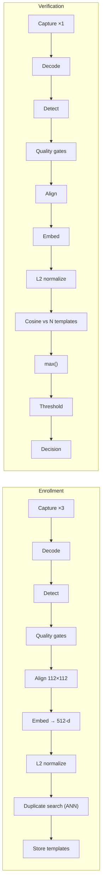

# 08 — AI Workflow

The face recognition pipeline: models, stages, thresholds, evaluation, and the limits we state openly.

---

## 1. Approach

**We do not train a model.** Face recognition is a solved research problem with strong open pretrained weights; a team of our size training from scratch would produce something worse than the baseline after months of GPU time. The engineering value is in everything around the model: quality gates, threshold calibration, tenancy, latency, auditability, and honest evaluation.

| Component | Choice | Why |
| --- | --- | --- |
| **Detection** | SCRFD-10GF (in `buffalo_l`) | Strong accuracy/latency balance on CPU; returns the 5 landmarks alignment needs, so detection and alignment share one pass |
| **Alignment** | Similarity transform to 112×112 from 5 landmarks | The canonical ArcFace preprocessing. Matching training-time preprocessing is not optional — a mismatch quietly destroys accuracy |
| **Recognition** | ArcFace `w600k_r50` (ResNet-50, WebFace600K) | 512-d embeddings, additive angular margin loss; the reference open model for verification |
| **Runtime** | ONNX Runtime, CPU EP | One artifact, deployable anywhere, no CUDA in the container. GPU EP is a config change, not a rewrite |
| **Vector math** | NumPy | Embeddings are L2-normalized, so cosine similarity is a dot product |

**Why InsightFace over `face_recognition`/dlib** — dlib's ResNet model is materially weaker on pose and lighting variation and is not a defensible basis for an authentication decision. Why not a cloud face API — it would make Fvas a reseller with no control over threshold, latency, residency, or cost.

## 2. Pipeline



### Stage detail

**1 · Decode & normalize.** Accept JPEG/PNG/WebP, ≤ 8 MB. Strip EXIF (it carries GPS and device identifiers — a privacy leak with no functional use), apply EXIF rotation first, convert to BGR `uint8`, downscale so the long edge is ≤ 1280 px. Downscaling before detection is the single biggest latency lever: detection cost is roughly quadratic in pixel count, and faces above ~112 px inter-ocular gain nothing from more resolution.

**2 · Detect.** SCRFD at `det_size=(640, 640)`, `det_thresh=0.5`. Returns bounding box, 5 landmarks, and a confidence per face.

- Zero faces → `inconclusive`, reason `no_face_detected`
- More than one face → `inconclusive`, reason `multiple_faces`. **Never** silently pick the largest face: in an authentication context, an unexpected second person in frame is a signal, not noise

**3 · Quality gates.** Run *before* embedding, because a bad template poisons every future verification against it, and because rejecting early saves the expensive stage.

| Gate | Measure | Default | Rationale |
| --- | --- | --- | --- |
| Face size | Inter-ocular distance in px | ≥ 112 | Below this the model interpolates detail it doesn't have |
| Sharpness | Variance of Laplacian, normalized | ≥ 0.35 | Motion blur is the top cause of false rejection in field use |
| Brightness | Mean luminance of the face crop | 0.25–0.85 | Under/over-exposure collapses texture |
| Contrast | Std-dev of luminance | ≥ 0.10 | Flat images carry little identity signal |
| Pose | \|yaw\| ≤ 25°, \|pitch\| ≤ 20°, \|roll\| ≤ 20° | | ArcFace degrades sharply past ~30° yaw |
| Occlusion | Landmark-confidence heuristic | — | Mask/sunglasses coverage |
| Detection confidence | SCRFD score | ≥ 0.60 | |

Gates are **stricter at enrollment than at verification**. A user enrolling is cooperative and can retry; a user authenticating at 11 pm in a badly lit warehouse cannot. Applying enrollment-grade strictness at verification produces a product that is technically accurate and practically unusable.

Each gate returns a normalized 0–1 score; `quality_score` is their weighted mean, which is what the UI displays and what feeds re-enrollment prompts.

**4 · Align.** Similarity transform from the 5 detected landmarks to ArcFace's canonical reference points → 112×112 BGR. This removes in-plane rotation and normalizes scale, which is why the embedding is comparable across captures at all.

**5 · Embed.** ArcFace forward pass → 512 floats, then L2-normalize. After normalization, cosine similarity is `np.dot(a, b)` and lands in `[-1, 1]`; in practice genuine pairs cluster around 0.5–0.9 and impostor pairs around −0.1–0.2.

**6 · Match.** Compare against every active template for the subject, take the maximum:

```python
scores = templates @ probe          # (N, 512) @ (512,) → (N,)
best = float(scores.max())
decision = "verified" if best >= threshold else "rejected"
```

Max rather than mean is deliberate. Templates deliberately cover different poses; averaging across them penalizes exactly the pose diversity that multi-shot enrollment exists to capture.

### Client-side hints are not gates

The capture UI computes exposure, focus and stability in the browser, on a
128×96 downscale of the preview, several times a second
([`frame-quality.ts`](../apps/web/src/lib/frame-quality.ts)). They exist for one
reason: telling someone their room is too dark costs 3 ms locally and a full
round trip plus an ONNX inference remotely, and a capture UI that can only say
"too dark" *after* submitting is one people give up on.

Three properties keep this from becoming a second, competing quality system:

* **Only the model-free gates are computed.** Face size and head pose need a
  detector; those come back from the server and drive the prompts from there.
  Shipping a second face model to the browser would cost megabytes and create a
  way for client and server to disagree about the same frame.
* **The thresholds are separate and deliberately so.** The browser measures the
  whole downscaled frame; the server measures the *face crop* at full
  resolution. The two scales are not comparable, and pretending they are would
  produce a HUD that contradicts the result.
* **The server decides.** A frame the browser is happy with can still be
  rejected, and the response is what the user is shown. Nothing client-side can
  cause a frame to be accepted.

## 3. Thresholds

The threshold is the product's central security/usability dial, and it must be **measured, not guessed**.

**Measured** on LFW — 8,559 genuine and 500,000 impostor pairs. Full run and
caveats in [docs/14-phase-0-spike.md](14-phase-0-spike.md).

| Preset | Cosine | Measured FAR | Measured FRR | Intent |
| --- | --- | ---: | ---: | --- |
| Lenient | 0.32 | 1.0×10⁻⁵ | 2.73% | High-volume, low-risk (retail check-in) |
| **Balanced** | **0.38** | **8.0×10⁻⁶** | **3.06%** | Default |
| Strict | 0.45 | 8.0×10⁻⁶ * | 4.21% | Financial transactions, admin access |
| Custom | 0.20–0.80 | — | — | Growth plan and above |

\* Identical to Balanced because beyond ~0.35 the impostor tail falls below what
500,000 pairs can resolve. Strict remains available as defence-in-depth against
a population harder than LFW, but its benefit is **unmeasured at this dataset
size** — not quantified.

The threshold at exactly FAR = 10⁻⁴ measures **0.260** (FRR 2.64%). The shipped
default stays at **0.380**: it buys FAR twelve times stricter than target for
+0.4 points of FRR, and LFW is easier than production, so a threshold tuned
exactly to its 10⁻⁴ point would drift toward false accepts on real captures.

**TAR @ FAR = 10⁻⁴ is 97.36%**, meeting the ≥97% goal in
[docs/01-prd.md §4](01-prd.md#4-goals--success-metrics).

> These figures come from a public benchmark, not from the deployment
> population. LFW is curated, frontal, well-lit, and demographically skewed. The
> per-slice results §4 commits to publishing are **still outstanding** — they
> cannot be produced from this dataset.

**Confidence bands** returned alongside the decision, because a bare boolean loses information the customer's risk engine can use:

| Band | Condition |
| --- | --- |
| `high` | `similarity ≥ threshold + 0.15` |
| `medium` | `threshold + 0.05 ≤ similarity < threshold + 0.15` |
| `low` | `threshold ≤ similarity < threshold + 0.05` — verified, but marginal |

A `low` band on a $50,000 transfer is exactly where a customer should trigger a second factor. Handing them that signal turns Fvas from a gate into an input to their risk model.

## 4. Evaluation & calibration

### Metrics

| Metric | Definition | Why it matters |
| --- | --- | --- |
| **FAR** | Impostor pairs accepted / all impostor pairs | The security number. An attacker gets in |
| **FRR** | Genuine pairs rejected / all genuine pairs | The usability number. A real user is locked out |
| **TAR @ FAR=1e-4** | True accept rate at a fixed operating point | The industry-comparable headline figure |
| **EER** | Where FAR = FRR | A single summary number; useful for comparing models, never for setting a production threshold |

**Accuracy is not reported.** On a balanced-looking pair set it hides the asymmetry that matters: a system with 99% accuracy and a 1% FAR is unacceptable for authentication, and the single number cannot tell you which error you're buying.

### Procedure

1. Assemble a validation set of genuine and impostor pairs — a public benchmark (LFW, CFP-FP, AgeDB-30) for a comparable baseline, plus an internally collected set that matches real deployment conditions (webcam capture, indoor lighting, Southeast Asian demographics — the deployment population).
2. Compute the similarity for every pair.
3. Sweep the threshold from 0.0 to 1.0 in 0.005 steps; record FAR and FRR at each.
4. Select the production default at the FAR the product targets (1e-4), then sanity-check the resulting FRR is tolerable. If it isn't, the answer is better capture quality, not a looser threshold.
5. **Re-run per demographic slice** and publish the per-slice FRR in the model card.
6. Store the curve as a committed artifact so a model change can be diffed against it.

Step 5 is not optional. Demographic differential performance in face recognition is documented and real; the responsible position is to measure it, publish it, and let customers make an informed decision — not to omit the measurement and hope.

### Continuous evaluation

`verification_sessions` stores every similarity score. The distribution of scores over time is monitored: a drift in the genuine-pair mode indicates a capture-quality regression (a customer changed cameras), and a rise in near-threshold decisions indicates the threshold no longer suits the traffic. The console's "Report false accept / false reject" control feeds a labelled set for recalibration.

## 5. Liveness — stated limits

**The MVP does not ship certified presentation-attack detection.** This is the product's most important honest limitation, and it is stated in the docs, the PRD, and the sales material rather than buried.

What ships:

| Layer | Mechanism | Stops | Doesn't stop |
| --- | --- | --- | --- |
| Screen-replay heuristics | Moiré pattern detection, screen-edge detection, specular uniformity | Casual phone-screen replay | A good screen at the right angle |
| Texture analysis | LBP variance on the face crop | Low-quality printed photos | High-quality prints |
| Active challenge (optional) | Randomized prompt (blink / turn left / turn right), 3 frames, verifies both the motion and that all frames match the same identity | Static photos, most printed attacks | A prepared video or deepfake |
| Metadata signals | Capture timing, device consistency | Naive replay of a stored image | A determined attacker |

**Positioning that follows from this:** Fvas is appropriate as a **step-up factor in a supervised or semi-supervised context**, where the attacker also needs the account, the device, and the session. It is **not** appropriate as the sole control for unsupervised remote onboarding against a motivated adversary. That is a scoping statement, not a disclaimer, and it is written into the docs site.

The roadmap slot: a dedicated PAD model behind a `LivenessDetector` interface, evaluated against ISO/IEC 30107-3 attack categories. The interface exists in the MVP so it is an addition, not a refactor.

## 6. Performance

**Measured**, not estimated — see [docs/14-phase-0-spike.md](14-phase-0-spike.md) for
the full run. Intel Core Ultra 7 258V, container capped at 4 CPUs, ONNX Runtime
1.20.1 CPU EP, warm model, `det_size=320`, 2 intra-op threads:

| Stage | Measured p95 | Original estimate |
| --- | --- | --- |
| JPEG decode | 4 ms | 15–30 ms |
| Detection (SCRFD-10GF @ 320) | 121 ms | 50–90 ms |
| Alignment | 1 ms | ~2 ms |
| Embedding (ArcFace R50) | 273 ms | 100–180 ms |
| Match (5 templates) | < 0.01 ms | < 1 ms |
| **Pipeline total** | **331 ms** | 200–350 ms |

The total landed inside the estimate, but the *distribution* did not: decoding
is far cheaper than assumed and embedding far more expensive. Embedding alone is
~80% of the budget, which is where any future optimisation has to go.

Add database and serialisation on top; the 800 ms p95 budget holds with room.

The API records these numbers per request, so the claim stays continuously
checkable rather than a benchmark frozen in a README.

Optimizations, in measured order of effect:

1. **Cap ORT threads explicitly.** `intra_op_num_threads` defaults to 0, meaning
   "every visible core" — and a container sees the host's cores regardless of
   its CPU quota. Left at the default under a 2-CPU limit, the pipeline measured
   **5× slower** (p95 1.7 s) purely from thread thrashing. This is the single
   largest effect measured, and it is a misconfiguration rather than a tuning
   knob. Note it is a *session* option; passing it via `provider_options` is
   silently ignored.
2. **`det_size=320`, not 640.** Detection at 640 costs ~3× as much (212 ms vs
   71 ms at 2 threads) for faces that already have to clear a 112 px
   inter-ocular gate. Validate against small-face recall in Phase 5.
3. **Give each worker 2 threads, not 1.** Single-threaded p95 was 565 ms —
   over budget. Two threads roughly halve it; four gain another 25%.
4. **Load models at startup**, never lazily. Warm load is ~1 s, cold ~2 min.
5. **Run inference off the event loop** via a bounded thread pool.
6. Batch only for enrollment (3 images), never for verification — batching a
   latency-critical single request adds queueing delay for no gain.
7. INT8 quantization, GPU EP, or a smaller backbone if the budget is ever
   missed — each trades measurable accuracy for latency, so each requires a
   re-run of §4.

> **Input resolution is not a lever.** The blueprint originally claimed
> downscaling before detection was "the largest single win". It is not:
> SCRFD resizes internally to `det_size` regardless, so 1280×720 and 640×480
> measured within noise of each other (350 ms vs 331 ms p95). Only JPEG decode
> differs, and that is 2–5 ms. The claim was wrong and is corrected here.

## 7. Model registry & upgrades

Every template records `model_name` and `model_version`. Embeddings from different models are **not comparable** — a silent model swap would look like a mass identity change.

Upgrade procedure:
1. Deploy the new model alongside the old; both loaded
2. Verification uses the model the template was created with, resolved per profile
3. New enrollments use the new model
4. Background re-enrollment where raw images were retained by consent; otherwise prompt the customer to re-enroll
5. Retire the old model only when zero active profiles reference it

Rejected alternative: a "big-bang" swap requiring every tenant to re-enroll every subject simultaneously. It is simpler to build and catastrophic to operate.

## 8. Privacy properties

| Property | Implementation |
| --- | --- |
| Images are not retained | Discarded after embedding unless the org explicitly opts in; retention window enforced by a nightly job |
| Templates are not images | A 512-d vector is not reversible to a photograph by any straightforward means. It is nonetheless treated as sensitive biometric PII — reconstruction research exists, and "hard to invert" is not "safe" |
| Templates are model-bound | Useless outside the exact model version, which limits the value of a leak |
| Deletion is physical | `DELETE`, not a flag, on template rows; the deletion event is recorded in the audit log |
| Tenant isolation | Templates carry `organization_id` and are never compared across tenants — including during duplicate detection |
| No training on customer data | Contractual and architectural. Customer images never enter a training pipeline, because there is no training pipeline |

## 9. Model licensing

InsightFace's pretrained packs are published for **non-commercial research use**. That is fine for an MVP, a portfolio, and a thesis defense — and it is a hard blocker for charging money.

The path is designed in, not bolted on: the `FaceEngine` protocol means a commercially licensed model, or one trained on a licensed dataset, replaces one adapter class. Nothing above the interface changes. Stating this openly is what separates a product plan from a demo — an investor will ask, and "we know, here's the swap and here's the cost" is a far better answer than discovering it in diligence.

---

**Next:** [09 — Security & Compliance](09-security.md)
