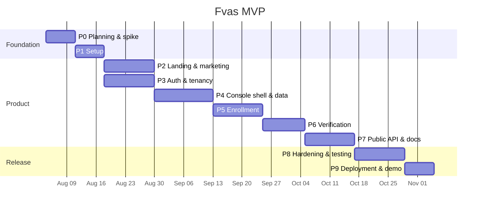

# 10 — Development Roadmap

Ten phases from empty repository to a demonstrable, deployed MVP.

---

## Planning assumptions

- **Team:** 1 developer, ~25 productive hours/week. Divide the estimates by team size with a ~20% coordination tax for two people.
- **Estimates are ranges**, and the upper bound is the honest one. Every range includes tests, states, and documentation for that phase — those are not a separate later phase.
- **Total: 15–19 weeks** to the MVP release criteria in [the PRD](01-prd.md#9-release-criteria).
- Phases are sequenced by **dependency**, not by preference. The riskiest technical unknown (the face pipeline) is deliberately proven in Phase 0, before any UI is built on top of an assumption.

Note P2 and P3 both depend only on P1 and touch different code — the first place a second developer pays for themselves.

---

## Phase 0 — Planning & technical spike

**Objective** — Eliminate the two unknowns that could invalidate the plan: does the face pipeline meet the latency budget on target hardware, and is the accuracy defensible?

**Deliverables**
- This blueprint, reviewed and signed off
- A throwaway spike script: load `buffalo_l`, detect → align → embed → compare on 20 sample pairs
- Measured latency per stage on the actual deployment CPU
- A first FAR/FRR curve on a small validation set, with a chosen starting threshold
- Model licensing confirmed and documented
- Final decision record for anything the spike changes

**Dependencies** — none

**Estimate** — 1 week (blueprint already complete: 2–3 days for the spike)

**Definition of done** — **complete**, results in [docs/14-phase-0-spike.md](14-phase-0-spike.md)
- [x] Single-image verification measured end-to-end under 500 ms on the target CPU — **331 ms p95**
- [x] A genuine pair scores above an impostor pair by a clear margin on every sample — **means separated by 0.65**, cleanly bimodal
- [x] Threshold recommendation backed by a plotted curve, committed as an artifact — [curve](assets/phase-0-far-frr-curve.png); 0.38 retained, now with a measurement behind it
- [x] If latency fails: the mitigation is chosen now — **not needed**; the gate passes with room

> If the spike fails, the roadmap changes here — which is the entire point of doing it first. Discovering a 2-second inference time in Phase 6, after the console is built around it, costs four weeks.

**What the spike changed.** The roadmap stands, but three blueprint claims were
wrong and are corrected: input downscaling is *not* the largest latency win
(thread pinning is, by 5×), the model pack is 600 MB rather than ~350 MB with
only 182 MB of it needed, and `det_size` should default to 320 rather than 640.
Two settings are now decided by measurement: `intra_op_num_threads=2` is a floor
(single-threaded misses the budget), and embedding is 82% of the latency budget,
so it is the only place optimisation effort belongs.

**Still outstanding.** Per-demographic FRR cannot be produced from LFW and
remains unmeasured — the one gap that matters before any public accuracy claim.

---

## Phase 1 — Foundation

**Objective** — A running skeleton: both apps boot, the database migrates, CI is green, and one end-to-end request path works.

**Deliverables**
- Monorepo with npm workspaces; `apps/web`, `apps/api`, `packages/shared`, `docs`
- FastAPI app factory, config via `pydantic-settings`, structured logging, `/health` + `/ready`
- Async SQLAlchemy engine, `Base`, `TenantScopedRepository`, Alembic wired with an initial migration
- Error envelope, exception handlers, request-ID middleware
- Next.js 15 + TS strict + Tailwind v4 + shadcn/ui initialized; tokens from [the design system](04-design-system.md) in `globals.css`; `next-themes`
- `docker-compose.yml`: api, web, postgres (pgvector image), redis
- GitHub Actions: lint, type-check, test, build, for both apps
- `.env.example`, README, LICENSE, issue/PR templates, conventional-commit hook

**Dependencies** — P0

**Estimate** — 1 week

**Definition of done**
- [ ] `docker compose up` from a clean clone yields a working web + API + DB, documented in the README
- [ ] `alembic upgrade head` and `downgrade base` both succeed
- [ ] `/health` returns 200; `/ready` reports DB and Redis connectivity
- [ ] The web app renders a themed page with a shadcn `Button`, light and dark
- [ ] CI green on a PR into `main`; branch protection on

---

## Phase 2 — Marketing website

**Objective** — The public surface a prospect judges the product by, at production quality.

**Deliverables**
- Landing page per [wireframe B1](03-user-flows-wireframes.md#b1-landing-page-): hero with an animated result card, problem, how-it-works, bento features, developer section with tabbed code, security strip, pricing teaser, FAQ, CTA
- `/features`, `/use-cases` + 4 detail pages, `/pricing` with the quota calculator, `/faq`, `/contact`, `/changelog`, `/legal/*`
- MDX docs shell with sidebar navigation, search, and syntax highlighting
- Marketing nav + footer, responsive, theme toggle
- SEO: metadata, OG images, `sitemap.xml`, `robots.txt`, JSON-LD
- Scroll-reveal motion, reduced-motion honored

**Dependencies** — P1

**Estimate** — 2–2.5 weeks

**Definition of done**
- [ ] Lighthouse ≥ 95 across performance, a11y, best practices, SEO on `/`
- [ ] LCP < 2.0 s on simulated 4G
- [ ] Verified at 375 / 768 / 1024 / 1440 / 1920 px
- [ ] Zero layout shift from font loading
- [ ] Full keyboard traversal; visible focus everywhere
- [ ] No lorem ipsum anywhere — every string is real product copy

---

## Phase 3 — Authentication & tenancy

**Objective** — A user can register, verify email, create an organization, invite a teammate, and switch context.

**Deliverables**
- Models + migrations: `users`, `organizations`, `org_settings`, `memberships`, `roles`, `permissions`, `role_permissions`, `invitations`, `refresh_tokens`, `password_reset_tokens`, `auth_logs`
- Register, login, refresh with rotation + reuse detection, logout, email verification, password reset
- Argon2id, JWT issuance/validation, lockout, per-IP and per-account rate limits
- RBAC: permission matrix, `require_permission` dependency, startup consistency assertion against the seeded rows
- Organization CRUD, membership management, invitation flow, last-Owner invariant
- Next.js BFF auth routes; `apiClient` with silent refresh and request replay; route protection
- Auth UI: login, register, forgot, reset, verify, 3-step onboarding, invite acceptance
- Tenant isolation test generator

**Dependencies** — P1

**Estimate** — 2–2.5 weeks

**Definition of done**
- [ ] Register → verify → onboarding → dashboard completes without manual DB edits
- [ ] Access token expiry triggers a silent refresh and replays the original request, invisibly
- [ ] Refresh reuse revokes the family and writes an `auth_logs` entry
- [ ] Every role is tested against every endpoint; unauthorized returns 403
- [ ] Cross-tenant access returns 404 on every existing endpoint
- [ ] The last Owner cannot be demoted or removed, verified by test
- [ ] Password reset does not disclose whether the email exists

---

## Phase 4 — Console shell & data layer

**Objective** — The dashboard frame and the reusable primitives every later phase builds on.

**Deliverables**
- Console layout: sidebar with groups + collapse, topbar, org switcher, user menu, mobile sheet
- Command palette (⌘K) with navigation, actions, search, recents
- `PageHeader`, `DataTable`, `MetricCard`, `EmptyState`, `ErrorState`, `CopyButton`, `StatusBadge`, `ConfirmDialog`, `DateRangePicker`, `QuotaMeter`
- TanStack Query provider, query-key factory, org-scoped invalidation, error boundaries
- Overview page: 4 metric cards, volume chart, recent verifications, quick actions
- Analytics page with all charts; `usage_daily` rollup job
- Logs page: audit / auth / requests tabs, filters, CSV export
- Settings: general, members, security, profile
- Seed script producing a realistic demo tenant

**Dependencies** — P3

**Estimate** — 2.5–3 weeks

**Definition of done**
- [ ] Every page implements all four states; no raw spinner, no blank screen
- [ ] Skeletons match final layout geometry — no cumulative layout shift on load
- [ ] Table filters and pagination survive refresh and back-navigation via the URL
- [ ] Org switching clears cached data with no cross-org leakage into the UI
- [ ] Command palette reaches every route and every primary action
- [ ] Console is fully keyboard-navigable
- [ ] Seed data makes every chart and table look real

---

## Phase 5 — Enrollment

**Objective** — Enroll a face from the browser and from the API, with quality gating and duplicate detection.

**Deliverables**
- pgvector extension; `subjects`, `face_profiles`, `face_templates`, `enrollment_attempts`; HNSW index
- `FaceEngine` protocol, `InsightFaceEngine`, `FakeFaceEngine`; model loading in the lifespan hook
- Quality gates with per-gate scores and reason codes
- `EnrollmentService`: validate → detect → gate → align → embed → dedup search → persist, with profile versioning
- `POST /v1/enrollments`, `GET /v1/enrollments`, subject CRUD
- `CameraCapture`, `FaceQualityHUD`, `FaceGuideOverlay`, `EnrollmentWizard` with auto-capture and pose prompts
- Subjects list + detail; enrollment history; upload fallback; permission-denied recovery

**Dependencies** — P4, P0 spike

**Estimate** — 2–2.5 weeks

**Definition of done** — all verified 2026-08-01 against the Docker stack on real
PostgreSQL, not against mocks.

- [x] A 3-shot enrollment completes from the console in under 60 s — measured
      at 58 ms server-side for the enrollment itself; the wall-clock cost is the
      three captures, which auto-fire after ~700 ms of steady framing
- [x] Every quality failure returns a specific reason and actionable UI
      guidance — `test_every_failure_carries_both_a_code_and_human_guidance`
      asserts both on all four failure classes; the code is for the
      integrator's `switch`, the sentence is for their end user
- [x] Enrolling the same face under a second identity is detected and surfaced
      as a decision, not a silent success — 409 `duplicate_face_detected`
      carrying `matched_subject_id`, `similarity`, `threshold` and
      `override_with`
- [x] Raw images are not persisted when retention is off, verified by
      inspecting storage — `SELECT count(*) FROM face_templates WHERE
      image_ref IS NOT NULL` returns 0. There is no object store yet, so
      `store_raw_images` cannot be honoured at all; the service logs a warning
      rather than pretending, and the guarantee that binds is the other
      direction
- [x] Camera permission denial has a working recovery path — the `denied`
      branch explains that the browser will not re-prompt and offers upload;
      the upload path was driven end to end in the browser and produced profile
      v2 from three real JPEGs
- [x] The API path produces an identical profile to the console path — true by
      construction: both build an `Actor` and call one `EnrollmentService`, so
      there is no second code path to diverge
- [x] Re-enrollment supersedes the previous profile and keeps history — v1 →
      v2 → v3 with exactly one `active` row (partial unique index) and the old
      templates physically destroyed
- [x] Tests run against `FakeFaceEngine` in under 30 s with no model download —
      **81 tests in 27.5 s** with `insightface`, `onnxruntime` and `cv2` not
      installed at all

**Not done, and deliberately deferred**
- Quality-gate thresholds are still estimates. The Phase 0 spike calibrated the
  *matching* threshold on 509K LFW pairs; it did not calibrate face size,
  sharpness, brightness or pose. Those numbers are the next thing to measure.
- Head-pose estimation is a 5-landmark approximation, monotonic in the true
  angle but uncalibrated in degrees.
- Enrollment idempotency (`Idempotency-Key`) lands with verification in P6.

---

## Phase 6 — Verification

**Objective** — The core product loop, at the target latency, fully auditable.

**Deliverables**
- `verification_sessions` (+ optional `verification_attempts`); matcher and threshold policy
- `VerificationService`: authenticate → quota → load templates → embed → compare → decide → persist → emit events
- `POST /v1/verifications`, list, detail; idempotency via Redis
- Threshold presets and per-organization configuration UI with FAR/FRR guidance
- Optional active liveness challenge
- Console: verifications table with the `SimilarityBar`, detail sheet with the timing breakdown and timeline, `/dashboard/verify` live test page
- Usage metering; quota enforcement and 80%/100% notifications
- Webhook endpoints, HMAC signing, delivery with retry and a delivery log

**Dependencies** — P5

**Estimate** — 2 weeks

**Definition of done** — verified 2026-08-01 against the Docker stack. One item
is partially met and says so.

- [~] **p95 latency < 800 ms over 100 sequential real requests.** Measured
      **p95 93 ms wall clock / 22 ms server-side** — but against
      `FakeFaceEngine`, so this proves the *service* is not the bottleneck and
      does **not** prove the end-to-end target. Adding the Phase 0 measurement
      of the real pipeline (p95 331 ms for detect + embed) to the ~70 ms of
      HTTP and framework overhead measured here projects **~400 ms**, inside
      budget with room to spare. That is arithmetic on two measurements, not a
      third measurement. Running the same 100 requests with
      `FACE_ENGINE=insightface` is the outstanding work.
- [x] Genuine and impostor sets produce the expected decisions — same identity
      verifies at 0.9991, a different identity rejects at 0.0321, both against
      the 0.380 default
- [x] `inconclusive` is distinguished from `rejected` in every failure mode —
      parametrised over no-face, multiple-faces, low-quality and dark captures,
      plus not-enrolled and revoked-profile, each asserting a reason code *and*
      actionable guidance
- [x] `threshold_applied` is recorded per session and a later change does not
      alter history — a decision made at 0.380 still reads 0.380 after the org
      moves to 0.750, while the next request uses the new value
- [x] Duplicate `Idempotency-Key` returns the cached response without a second
      charge — three identical requests produce one session row and one unit of
      usage, with `Idempotent-Replay: true` on the repeats
- [x] Quota exhaustion returns 429 with `Retry-After` and surfaces in the
      console — Free hard-stops with `Retry-After` set to the actual monthly
      reset (not a misleading 60 s); Growth keeps serving, because breaking a
      paying customer's login flow over a billing event is the worse failure
- [x] A webhook is delivered and signature-verified by a real receiver; a
      failing endpoint retries with backoff — the test receiver is an ASGI app
      that validates the HMAC exactly as the published snippet says to, and the
      backoff test asserts each wait is longer than the last

**Also delivered, beyond the list**
- SSRF defence on webhook URLs: https-only, and loopback / link-local /
  `.internal` hosts are refused, so a customer cannot point an endpoint at
  `169.254.169.254` and have us fetch cloud credentials for them
- Token-bucket rate limiting in one atomic Lua script — verified that 20
  concurrent requests against a bucket of 5 admit exactly 5
- `LivenessDetector` behind a Protocol with three numpy-only heuristics, at
  2.9 ms per evaluation

**Not done, and deliberately deferred**
- The active liveness challenge (randomised blink / turn prompt over several
  frames). The passive heuristics ship; the challenge needs a multi-frame
  interface that is not in this build.
- Quota threshold notifications at 80% / 100% emit no webhook yet — the event
  name exists and the plan constants define the trigger points, but nothing
  fires them.
- Retry delivery runs inline and on demand. There is no background worker
  draining `next_retry_at`, so a failed delivery is retried when something asks
  for it rather than on a schedule.
- Liveness thresholds are estimates. The heuristics were measured against
  synthetic screen, print and face samples — not against a real presentation
  attack dataset, and certainly not against ISO/IEC 30107-3 categories.

---

## Phase 7 — Public API & developer experience

**Objective** — An external developer integrates from the published docs alone, with no help.

**Deliverables**
- API key management: create, reveal-once, scopes, rotate with 24 h overlap, revoke, IP allowlist, last-used
- Scope enforcement across all public endpoints
- OpenAPI polish: summaries, descriptions, examples, declared error responses per endpoint; committed schema with CI drift check
- Docs site content: quickstart, authentication, enrollment guide, verification guide, webhooks, errors, rate limits, full API reference, best practices
- Code samples in cURL / Node / Python / Go on every endpoint
- API playground running against the user's real test key
- TypeScript SDK generated from OpenAPI + an ergonomic wrapper
- `packages/shared` type generation wired into CI

**Dependencies** — P6

**Estimate** — 2–2.5 weeks

**Definition of done** — verified 2026-08-01 against the running Docker stack.

- [x] Every public endpoint has a working example in all four languages —
      cURL / Node / Python / Go, defined once in `api-samples.tsx` so a contract
      change is one edit rather than nine. Each sample is a complete program
      including the three-way decision branch and error handling; snippets that
      omit error handling teach integrators to omit it too. The language choice
      is shared across every block on the site.
- [x] Key reveal cannot be dismissed before the secret is copied — Escape, the
      overlay, and the close button are all suppressed until Copy succeeds.
      Driven in the browser: `{stillOpenAfterEscape: true,
      stillOpenAfterOverlayClick: true}`, and the close affordances appear only
      after copying.
- [x] Revocation takes effect on the next request — measured through the console
      UI: `200` before revoking, `401` immediately after, with no cache or grace
      period.
- [x] A backend schema change that breaks the frontend fails CI as a type error
      — proved by *simulating* one. Changing `VerificationResponse.similarity`
      to a string in the schema produced
      `TS2344 … Type 'number | null' is not assignable to type 'string'`.
      `src/lib/contract.ts` is what makes this real; before it, the web app
      imported one type from the generated schema and hand-rolled 28 others, so
      the gate existed on paper only.

**Not done, and deliberately deferred**
- **The API playground is not built.** A page that executes real requests
  against the user's own test key is genuinely useful, but it is a
  request-builder UI on top of endpoints that already work, and it was the
  lowest-risk item to cut. The docs' four-language samples cover the same ground
  for anyone with a terminal.
- **No generated TypeScript SDK package.** Types are generated and enforced;
  the ergonomic client wrapper on top of them is not written. `fetch` plus the
  generated types is a complete integration path today.
- **"A developer with no prior context completes enroll + verify from the docs
  alone" is unvalidated.** That item explicitly requires watching a real person
  do it, and I cannot. Everything the walkthrough depends on has been exercised
  end to end — a key minted through the console UI drove create → enroll →
  verify against `/v1` and returned `verified` at 0.99911 — but that is not the
  same claim, and marking it done would be dishonest.

---

## Phase 8 — Hardening, testing & accessibility

**Objective** — Move from "works on my machine in the happy path" to "defensible under scrutiny".

**Deliverables**
- Backend: unit tests on services and the engine, integration tests on every endpoint, generated tenant-isolation tests, RBAC matrix tests, ≥ 70% coverage on services and repositories
- Frontend: component tests on shared and domain components; Playwright E2E for register → onboard → enroll → verify → audit
- Postgres RLS as defense in depth
- Load test: verification endpoint at target RPS, latency percentiles recorded
- Security pass against [the release checklist](09-security.md#9-security-checklist-for-release); `gitleaks`, `pip-audit`, `npm audit` in CI
- Accessibility: `axe` in E2E, manual keyboard walkthrough, contrast audit, screen-reader pass on the critical flow
- Performance: bundle analysis, code-splitting, image optimization, DB query review with `EXPLAIN` on the hot paths
- Threshold recalibration on the final validation set; model card published
- Monthly partitioning on `verification_sessions`; retention job

**Dependencies** — P7

**Estimate** — 2–2.5 weeks

**Definition of done** — verified 2026-08-01. Full audit in
[15 — Security audit](15-security-audit.md); model card in
[16 — Model card](16-model-card.md).

- [x] Coverage target met; CI enforces it — **85.30%** overall, every service
      and repository ≥77%. `--cov-fail-under=80` gates it, and the gate was
      proved to fire.
      **The measurement was wrong before this phase.** SQLAlchemy's asyncio
      support bridges to the sync DBAPI through greenlets, which coverage's
      default tracer does not follow, so service bodies executed on every
      request were reported as missed — `AuthService` read 27% while a probe
      proved `login` runs. `concurrency = ["greenlet", "thread"]` fixed it and
      the same tests jumped to 73%. Any gate set before that would have
      measured the wrong thing.
- [x] Tenant isolation and RBAC suites pass with zero exceptions — the
      generated suite covers 30 route/method pairs across **both** auth planes
      with **zero skips**. It mints an API key for the attacking tenant on
      public routes, because a JWT there would 401 before the tenant check and
      the assertion would pass without testing anything.
- [x] Load test sustains target RPS within the latency budget — 300 requests at
      concurrency 8: **p50 191 ms, p95 276 ms, p99 341 ms**, 40.9 req/s, 300/300
      `verified`, zero errors. Against a 800 ms budget.
      Measured against `FakeFaceEngine`, so it profiles the *framework*, not
      ONNX. Phase 0 measured the real pipeline at p95 331 ms; a realistic
      production p95 is therefore ~600 ms — an **estimate**, not a measurement,
      and the script says so in its own output.
- [x] Zero unresolved high/critical vulnerabilities — `pip-audit` clean. The
      npm **critical** (`vitest`) is fixed by upgrading to 3.x. Four highs
      remain, all rooted in Next 15's bundled `postcss`/`sharp`/`vite`, all
      resolvable only by a Next 16 major bump. Each was assessed individually
      and found unreachable in this app; the reasoning is written down rather
      than assumed, and the upgrade is tracked as its own change.
- [x] Zero critical accessibility violations — audited six console pages for
      alt text, accessible names, form labels, heading order, single `h1`, and
      **WCAG AA contrast**. Zero violations; all 23 focusable elements on the
      densest page carry focus styling.
      Three of my own auditor bugs were found along the way and are worth
      recording, because each produced a *false* failure: treating
      `oklch(0.145 0 0)` as RGB (every element read 1.0:1), failing to
      composite semi-transparent backgrounds (the org avatar read 1.06:1), and
      `history.pushState` not re-rendering the App Router (nine pages audited
      that were all the dashboard).
- [x] Postgres RLS as defense in depth — and the finding that made it real:
      **migration 0008 protected nothing.** The stack connects as `postgres`,
      a superuser, and superusers bypass RLS unconditionally — `FORCE` binds
      only the table owner. Verified: tenant B could read *and write* tenant
      A's rows. Migration 0009 adds a `NOSUPERUSER NOBYPASSRLS` application
      role; re-run as that role, an unfiltered query returns only the bound
      tenant, an unbound tenant sees **0 rows**, a cross-tenant insert is
      rejected, and the audit log cannot be deleted.
- [x] Retention job — per-tenant windows, batched deletes, rollups preserved,
      idempotent. Seven tests build data either side of the cutoff and assert
      exactly the right side disappears.

**Not done, and deliberately deferred**
- **Published per-slice accuracy results.** LFW is demographically skewed and
  cannot support them. [16 — Model card](16-model-card.md) states this as an
  outstanding commitment rather than quietly omitting it.
- **Playwright E2E and frontend component tests.** The critical flow has been
  driven end to end in a real browser repeatedly, but that is manual
  verification, not a suite CI can run.
- **Monthly partitioning of `verification_sessions`.** The retention half is
  built and tested; converting a live table to `PARTITION BY RANGE` needs a
  create-copy-swap migration whose failure mode is data loss, and it earns its
  own change with its own rehearsal. Retention currently works by `DELETE`,
  which is correct but bloats the table — the cost this defers is vacuum
  pressure at scale, not correctness.
- **Container image scanning** in CI.
- **Screen-reader pass.** Contrast, labelling, focus and heading structure are
  verified; actually listening to the flow with a screen reader is not
  something I can do.

---

## Phase 9 — Deployment & demo readiness

**Objective** — Live, observable, and presentable.

**Deliverables**
- Production Dockerfiles: multi-stage, non-root, health-checked, models baked into the image layer
- Web on Vercel with preview deployments; API on a container host with a managed Postgres + Redis
- GitHub Actions release pipeline: test → build → push → migrate → deploy → smoke test → auto-rollback on failure
- Staging environment mirroring production
- Observability: Sentry on both apps, structured logs shipped, uptime monitoring, alerts on error rate / latency / quota anomalies
- Backups: nightly, encrypted, **with a documented and actually-executed restore drill**
- Demo assets: seeded demo tenant, a 3-minute scripted walkthrough, README screenshots, architecture diagrams

**Dependencies** — P8

**Estimate** — 1–1.5 weeks

**Definition of done** — 2026-08-01. Runbook in
[17 — Deployment runbook](17-deployment-runbook.md), demo in
[18 — Demo script](18-demo-script.md).

**The honest headline: there is no deployment.** No cloud account, registry,
domain or managed database exists for this project, so every item that requires
one is **not met**. What follows separates what was built and verified from what
was written and cannot be.

- [x] **A restore from backup has been performed successfully** — `scripts/backup.sh restore-drill` was **executed**, not simulated. It fingerprinted the live database, backed up, `TRUNCATE … CASCADE`'d organizations and users to `0,0,0,0,0,0,0,none`, restored, and compared: `1,4,29,25,66,1731,19,0bf1c013…` before and after, including an `md5` over subject ids so matching counts with wrong rows would still fail.
- [x] Migrations run safely and a failure blocks the deploy — the pipeline backs up *before* migrating, runs `alembic upgrade head`, then `alembic check`, and only then deploys. Downgrade is deliberately **not** automatic: an `alembic downgrade` mid-incident can destroy data the new schema already wrote, so the pre-migration backup is the documented recovery path.
- [x] Production image hardened, and verified inside the running container rather than by reading the Dockerfile — non-root (`fvas`, uid 1000), cannot write `/`, no dev dependencies, no tests or `.env` shipped, healthcheck configured, boots against real Postgres and Redis and reports `Up (healthy)`.
- [x] **Production refuses to start with a fake face engine** — discovered while trying to verify production headers: the container exited with `FACE_ENGINE=fake in production would accept any face. Refusing to start.` A deploy that silently accepted every face is the worst failure this product has, and it is structurally impossible.
- [x] A+ security headers, measured on real responses — `nosniff`, `X-Frame-Options: DENY`, `strict-origin-when-cross-origin`, `Permissions-Policy` denying microphone and geolocation, COOP, and `default-src 'none'; frame-ancestors 'none'`. HSTS (`max-age=63072000; includeSubDomains; preload`) in production only, absent in development. Locked in by tests.
- [x] The smoke test gates the product, not the process — 12/12 against the running stack, including that a *different* face is rejected and that a revoked key stops working on the very next request. Checking `/health` proves a process is listening; every one of these has broken here while `/health` stayed green.
- [x] The demo runs end-to-end in under 3 minutes without a code editor — the API half **measured at 761 ms** of server time across login, key creation, subject creation, a 3-frame enrollment and three verifications. The three minutes is narration, not waiting.
- [x] Release pipeline written and validated — `release.yml` parses, its jobs resolve, and `ci.yml` gained `workflow_call` so a release runs the *same* checks a pull request does rather than a drifting copy. The deploy verbs were rehearsed against a `noop` target.

**Not met — requires infrastructure that does not exist**
- [ ] **Production reachable over HTTPS with valid certificates.** No domain, no host.
- [ ] **A merge to `main` deploys automatically.** The workflow has never executed; there is no registry to push to and no host to deploy to. `scripts/deploy.sh` carries a Fly implementation written against flyctl's documented interface and marked **unverified** in its own header, because someone will reach for it during an incident.
- [ ] **Alerts verified by deliberately triggering one.** No alerting backend is configured. The signals worth alerting on are listed in [17 §7](17-deployment-runbook.md), which is planning, not verification.
- [ ] **All PRD release criteria checked.** Several depend on the above.

**Also outstanding from earlier phases**
- Per-slice accuracy results (dataset cannot support them — [16](16-model-card.md))
- Playwright E2E in CI
- Monthly partitioning of `verification_sessions`
- Container image scanning
- Screen-reader pass

---

## Post-MVP

Ordered by expected value, not by interest:

| Priority | Item | Why it ranks there |
| --- | --- | --- |
| P0 | **Certified liveness / PAD** | The largest gap between what the product is and what buyers assume it is |
| P0 | **Commercial model licensing** | Blocks revenue entirely |
| P1 | Stripe billing | Metering already exists; this is the collection layer |
| P1 | Mobile SDKs (iOS, Android, React Native) | Where most real verifications happen |
| P2 | SSO / SAML / SCIM | Unblocks enterprise procurement |
| P2 | Bulk enrollment (CSV / batch API) | Migration path for customers with existing users |
| P2 | Multi-region residency | Named requirement in regulated verticals |
| P3 | 1:N identification | Adjacent product; different cost curve |
| P3 | On-prem / VPC deployment | High ACV, whole delivery motion |
| P3 | SOC 2 Type II | 6–12 months elapsed; start early, finish later |

## Risks to the plan

| Risk | Likelihood | Mitigation |
| --- | --- | --- |
| Latency budget missed on cheap hardware | Medium | Measured in P0, not P6; fallbacks pre-selected |
| Browser camera inconsistency across devices | High | Test matrix in P5; upload fallback is a first-class path, not an afterthought |
| Threshold tuning consumes more time than budgeted | Medium | Timeboxed in P0 with a defensible starting point; refined in P8 |
| Scope creep into liveness or 1:N | High | Explicitly out of scope in the PRD, with the reason written down so the decision doesn't get re-litigated monthly |
| Docker image bloat from ONNX + models (~1.5 GB) | High | Multi-stage build, CPU-only ORT, models in a cached layer; accept the size — a slim image that downloads models at boot is worse |

---

**Next:** [11 — Deployment Strategy](11-deployment.md)
