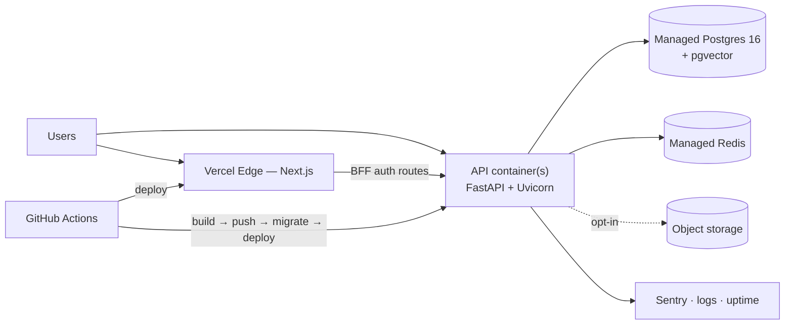

# 11 — Deployment Strategy

Local development, environments, CI/CD, observability, and what it costs to run.

---

## 1. Topology



**Why the web and API deploy separately.** They have opposite runtime profiles: the web app is static-heavy and benefits from edge distribution and instant rollbacks; the API is a long-lived stateful process that must load 400 MB of ONNX weights at startup and keep them resident. Forcing both into one deployment target compromises whichever one loses the argument.

**Why not serverless for the API** — cold starts. See [architecture §2](05-architecture.md#2-architectural-style-modular-monolith).

## 2. Environments

| | Local | Staging | Production |
| --- | --- | --- | --- |
| Web | `localhost:3000` | Vercel preview | Vercel production |
| API | Docker Compose | Container host, 1 instance | Container host, 2+ instances |
| Postgres | Compose container | Managed, small | Managed, HA, PITR |
| Redis | Compose container | Managed, small | Managed |
| Models | Mounted volume | Baked into image | Baked into image |
| Data | Seeded demo tenant | Anonymized seed | Real |
| Secrets | `.env` | Platform store | Platform store |
| Deploy on | manual | merge to `develop` | merge to `main` |

Staging exists specifically to catch migration and configuration problems, so it runs the **same image** as production and differs only in scale and data. A staging environment built differently from production tests the wrong thing.

## 3. Local development

```yaml
# docker-compose.yml (abridged)
services:
  postgres:
    image: pgvector/pgvector:pg16
    environment: { POSTGRES_DB: fvas, POSTGRES_PASSWORD: postgres }
    ports: ["5432:5432"]
    volumes: ["pgdata:/var/lib/postgresql/data"]
    healthcheck:
      test: ["CMD-SHELL", "pg_isready -U postgres"]
      interval: 5s
      retries: 10

  redis:
    image: redis:7-alpine
    ports: ["6379:6379"]

  api:
    build: { context: ./apps/api, dockerfile: Dockerfile, target: development }
    env_file: .env
    ports: ["8000:8000"]
    volumes:
      - ./apps/api:/app
      - models:/root/.insightface        # persists the model download
    depends_on:
      postgres: { condition: service_healthy }
      redis:    { condition: service_started }
    command: uvicorn app.main:app --host 0.0.0.0 --port 8000 --reload

  web:
    build: { context: ./apps/web, target: development }
    env_file: .env
    ports: ["3000:3000"]
    volumes: ["./apps/web:/app", "/app/node_modules", "/app/.next"]
    depends_on: [api]

volumes: { pgdata: , models: }
```

The named `models` volume matters more than it looks: without it, every `docker compose down` throws away a **600 MB** download that takes ~2 minutes to re-fetch (measured — see [docs/14](14-phase-0-spike.md#6-model-pack-size--a-correction)). Small detail, large daily cost.

```bash
git clone <repo> && cd fvas
cp .env.example .env
docker compose up -d
docker compose exec api alembic upgrade head
docker compose exec api python -m app.cli seed
```

`make` targets wrap the common operations: `make up`, `make down`, `make logs`, `make migrate`, `make revision m="..."`, `make seed`, `make test`, `make lint`, `make fmt`, `make reset-db`.

## 4. Container images

### API — multi-stage

```dockerfile
FROM python:3.12-slim AS base
ENV PYTHONUNBUFFERED=1 PIP_NO_CACHE_DIR=1
RUN apt-get update && apt-get install -y --no-install-recommends \
      libgl1 libglib2.0-0 curl && rm -rf /var/lib/apt/lists/*
WORKDIR /app

FROM base AS deps
COPY pyproject.toml uv.lock ./
RUN pip install uv && uv sync --frozen --no-dev

FROM deps AS models
# Bake the model pack into its own layer — cached across code changes
RUN python -c "import insightface; insightface.app.FaceAnalysis(name='buffalo_l').prepare(ctx_id=-1)"

FROM models AS production
COPY app ./app
COPY alembic alembic.ini ./
RUN useradd -m -u 1000 fvas && chown -R fvas:fvas /app /home/fvas
USER fvas
EXPOSE 8000
HEALTHCHECK --interval=30s --timeout=5s --start-period=40s \
  CMD curl -fsS http://localhost:8000/health || exit 1
CMD ["uvicorn","app.main:app","--host","0.0.0.0","--port","8000","--workers","2"]
```

Decisions worth naming:

- **`libgl1` and `libglib2.0-0`** are required by OpenCV. Omitting them produces an import error at runtime that costs an hour to diagnose the first time.
- **Models in their own layer, before the code copy.** A code change rebuilds the last layer only; the model layer stays cached. Reversing this order makes every deploy a multi-minute download.
- **Copy only the two models that are used.** `buffalo_l` downloads 600 MB: a 275 MB archive that is *retained after extraction*, plus six models of which the pipeline uses exactly two — `det_10g.onnx` (16 MB) and `w600k_r50.onnx` (166 MB). Keeping only those and deleting the archive cuts ~418 MB. Calling `FaceAnalysis(...).prepare()` at build time, as earlier drafts of this file sketched, leaves all of it in the layer.
- **Non-root user.** Required by most container platforms' security policies and correct regardless.
- **`--start-period=40s`** on the health check, because model loading takes real time and an orchestrator would otherwise kill the container before it finished booting.
- **Image size is roughly 1 GB and that is accepted.** The alternative — downloading models at boot — trades a one-time build cost for a per-start failure mode that depends on an external host being up. Wrong trade for an auth service.

Worker count: models load per worker, so N workers hold N copies of ~400 MB. `--workers 2` on a 2 GB instance is the ceiling; scaling goes horizontal, not by adding workers.

### Web

Standard Next.js multi-stage build with `output: "standalone"`. On Vercel this is used only for local parity and self-hosted deploys — Vercel builds from source.

## 5. CI/CD

### Pull request pipeline

```yaml
# .github/workflows/ci.yml (abridged)
on: { pull_request: { branches: [main, develop] } }

jobs:
  api:
    runs-on: ubuntu-latest
    services:
      postgres:
        image: pgvector/pgvector:pg16
        env: { POSTGRES_PASSWORD: postgres }
        options: >-
          --health-cmd pg_isready --health-interval 5s --health-retries 10
      redis: { image: redis:7-alpine }
    steps:
      - uses: actions/checkout@v4
      - uses: astral-sh/setup-uv@v3
      - run: uv sync --frozen
      - run: uv run ruff check . && uv run ruff format --check .
      - run: uv run mypy app
      - run: uv run alembic upgrade head
      - run: uv run pytest --cov=app --cov-fail-under=70
        env: { FACE_ENGINE: fake }

  web:
    steps:
      - uses: actions/checkout@v4
      - uses: actions/setup-node@v4
        with: { node-version: 22, cache: npm }
      - run: npm ci
      - run: npm run lint && npm run type-check
      - run: npm run test
      - run: npm run build

  contract:
    needs: [api]
    steps:
      - run: uv run python -m app.cli export-openapi > openapi.json
      - run: npx openapi-typescript openapi.json -o packages/shared/api.d.ts
      - run: git diff --exit-code   # fails if the committed schema drifted

  security:
    steps:
      - uses: gitleaks/gitleaks-action@v2
      - run: uv run pip-audit
      - run: npm audit --audit-level=high
```

`FACE_ENGINE: fake` is what keeps CI at ~2 minutes instead of ~10 — no model download, deterministic embeddings. This is the direct payoff of the `FaceEngine` protocol, and it is why that abstraction earns its keep on day one rather than someday.

The `contract` job is the mechanism that makes "the OpenAPI schema is the source of truth" enforceable rather than a wish.

### Release pipeline (`main`)

```
test → build image → push to registry → run migrations → deploy →
smoke test (health, login, a real test-mode verification) →
on failure: automatic rollback to the previous image
```

**Migrations run as a separate step before the deploy, not on application startup.** Startup migrations race across replicas and turn a bad migration into a crash loop with no clean rollback. Running them once, gated, with the deploy blocked on failure, is the difference between a bad deploy and an outage.

Rule for migrations: **expand, then contract.** A column rename ships as add → backfill → dual-write → switch reads → drop, across separate deploys. It is more work and it is the only way to deploy without a maintenance window.

## 6. Configuration

`.env.example` documents every variable. `pydantic-settings` validates at startup and **exits on anything missing or malformed** — a misconfigured deploy should fail loudly in the first second, not serve broken requests for an hour.

| Variable | Example | Notes |
| --- | --- | --- |
| `ENVIRONMENT` | `production` | Gates `/docs` exposure and debug output |
| `DATABASE_URL` | `postgresql+asyncpg://…` | |
| `REDIS_URL` | `redis://…` | |
| `JWT_SECRET_KEY` | 64-byte random | Rotating it invalidates all sessions |
| `ACCESS_TOKEN_EXPIRE_MINUTES` | `15` | |
| `REFRESH_TOKEN_EXPIRE_DAYS` | `30` | |
| `CORS_ORIGINS` | `https://app.fvas.io` | Comma-separated allowlist, never `*` |
| `FACE_ENGINE` | `insightface` \| `fake` | |
| `FACE_MODEL_NAME` | `buffalo_l` | |
| `DEFAULT_MATCH_THRESHOLD` | `0.38` | Per-org override in `org_settings` |
| `MAX_IMAGE_SIZE_MB` | `8` | |
| `ONNX_INTRA_OP_THREADS` | `2` | |
| `RATE_LIMIT_ENABLED` | `true` | |
| `SENTRY_DSN` | | Optional |
| `SMTP_*` | | Transactional email |

`/docs` and `/redoc` are disabled in production for the console API surface and served publicly only for `/v1`.

## 7. Observability

| Signal | Tool | What it answers |
| --- | --- | --- |
| Errors | Sentry (both apps), tagged with `request_id` and `org_id` | What broke, for whom, with the trace |
| Logs | `structlog` JSON to stdout → platform aggregator | What happened in this request |
| Uptime | External monitor on `/health`, 1 min | Are we up, from outside |
| Metrics | `/metrics` (Prometheus format) | Request rate, latency histogram, verification decisions, quota burn, model inference time |
| Product analytics | The `usage_daily` table | Are customers actually using it |

**Alerts** — 5xx rate > 1% over 5 min; p95 verification latency > 1.5 s over 5 min; DB connection-pool exhaustion; Redis unreachable; `token_reuse_detected`; webhook failure rate > 20%; disk above 80%.

Every alert must be actionable. An alert nobody acts on trains the team to ignore the channel, which is worse than having no alerting.

**Golden signals for this product specifically:** verification p95 latency, verification error rate (`decision = "error"`, distinct from `rejected`), and quota-limit rejections. Those three cover "is it fast", "is it broken", and "is a customer being blocked by us".

## 8. Backup & recovery

| | Policy |
| --- | --- |
| Automated backups | Nightly full, encrypted, 30-day retention |
| Point-in-time recovery | 7 days (managed Postgres WAL) |
| Restore drill | **Quarterly, executed and documented** |
| RPO | ≤ 5 minutes (PITR) |
| RTO | ≤ 1 hour |

A backup that has never been restored is a hypothesis. The Phase 9 DoD requires an actual restore before launch.

## 9. Scaling path

Written down so that scaling is a decision with a trigger, not a panic:

| Bottleneck | Signal | Action |
| --- | --- | --- |
| CPU on inference | p95 latency rising with request rate | Add API instances horizontally |
| DB connections | Pool exhaustion errors | PgBouncer in transaction mode |
| Read load on analytics | Slow dashboard queries | Read replica; analytics already reads rollups |
| `verification_sessions` size | Slow queries, growing storage | Monthly partitioning + retention (planned for P8) |
| pgvector memory | Dedup search latency climbing | Partition the index by org; or move dedup to a dedicated vector store |
| Model inference dominating | Inference > 60% of request time | Extract to a `RemoteFaceEngine` inference service — the interface already exists |

The last row is the payoff of the `FaceEngine` abstraction: the microservice we deliberately didn't build in Phase 1 becomes a scheduled, low-risk change when the metric that justifies it actually appears.

## 10. Cost model

Order-of-magnitude monthly, for planning:

| Stage | Infrastructure | Estimate |
| --- | --- | --- |
| **Development** | Local Docker + free tiers | **$0** |
| **Demo / portfolio** | Vercel Hobby, 1 small API instance, small managed PG + Redis | **~$25–40** |
| **Early production** | Vercel Pro, 2× API (2 vCPU/4 GB), PG with PITR, Redis, Sentry | **~$150–250** |
| **Scale (≈1M verifications/mo)** | 4–6 API instances, larger PG, replica, object storage | **~$600–1,000** |

At 1M verifications on ~$800 of infrastructure, cost is ~$0.0008 per verification against $0.002–0.004 of revenue — a defensible gross margin that improves with scale, which is exactly the question an investor asks after the demo.

---

**Next:** [12 — Repository Standards](12-repository-standards.md)
