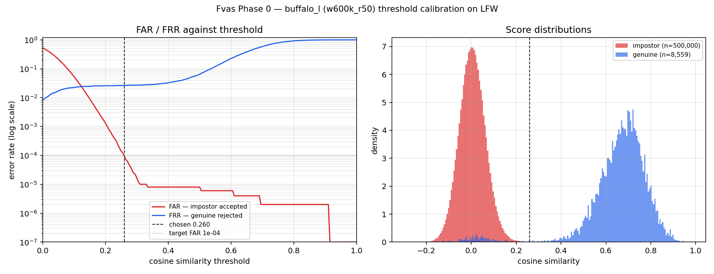

# 14 — Phase 0 Spike: Face Pipeline

**Run:** 1 August 2026 · **Harness:** [`spikes/phase-0-face-pipeline/`](../spikes/phase-0-face-pipeline/)

Phase 0 exists to answer two questions before anything is built on top of their
answers: **is the pipeline fast enough**, and **what is the threshold, measured
rather than guessed**. Both are now answered.

---

## Verdict

| Gate | Result |
| --- | --- |
| Single verification p95 under 500 ms on the target CPU | **PASS** — 331 ms at the production configuration |
| A genuine pair scores clearly above an impostor pair | **PASS** — means separated by 0.65 with clean bimodal distributions |
| Threshold backed by a plotted curve, committed | **PASS** — [curve below](#3-threshold-calibration) |
| Model licensing confirmed | **Partially** — package MIT confirmed; weights restriction unchanged and still blocking for revenue |

**The roadmap does not change.** Phases 5 and 6 proceed as written. Two
configuration decisions are now settled by measurement rather than assumption,
and three claims in the blueprint were wrong and have been corrected.

## 1. Environment

| | |
| --- | --- |
| CPU | Intel Core Ultra 7 258V (Lunar Lake), 8 cores |
| SIMD | AVX, AVX2, FMA — **no AVX-512** |
| Container | `python:3.12-slim`, `--cpus=4` quota |
| Runtime | ONNX Runtime 1.20.1, CPUExecutionProvider |
| Models | `buffalo_l` — SCRFD-10GF (`det_10g`) + ArcFace R50 (`w600k_r50`) |
| Host | Docker Desktop on Windows 11 (WSL2) |

> **This is a development laptop, not the production server.** The numbers
> establish feasibility and the *shape* of the budget — which stage dominates,
> which knobs matter — and those transfer. The absolute p95 must be re-measured
> on the actual deploy target before the SLA in
> [docs/01-prd.md](01-prd.md#4-goals--success-metrics) is promised to anyone.

## 2. Latency

Per-stage p95 across a sweep of thread counts, detector resolutions, and input
sizes. 5 warmup + 30 measured iterations each.

### The production configuration

`det_size=320`, 2 intra-op threads, 640×480 input:

| Stage | p95 | Share |
| --- | --- | --- |
| JPEG decode | 4 ms | 1% |
| Detection (SCRFD-10GF) | 121 ms | 37% |
| Alignment | 1 ms | < 1% |
| Embedding (ArcFace R50) | 273 ms | 82% |
| Match (5 templates) | < 0.01 ms | 0% |
| **Total** | **331 ms** | |

Shares exceed 100% because stage p95s do not co-occur; the total is its own
measured p95, not a sum.

### Full sweep

| threads | det_size | input | detect p95 | embed p95 | **total p95** |
| ---: | ---: | --- | ---: | ---: | ---: |
| 1 | 320 | 640×480 | 142 ms | 458 ms | **565 ms** |
| 1 | 320 | 1280×720 | 163 ms | 475 ms | **573 ms** |
| 1 | 640 | 640×480 | 766 ms | 442 ms | **1098 ms** |
| 1 | 640 | 1280×720 | 500 ms | 500 ms | **933 ms** |
| **2** | **320** | **640×480** | **121 ms** | **273 ms** | **331 ms** |
| 2 | 320 | 1280×720 | 91 ms | 295 ms | **350 ms** |
| 2 | 640 | 640×480 | 303 ms | 294 ms | **511 ms** |
| 2 | 640 | 1280×720 | 209 ms | 180 ms | **375 ms** |
| 4 | 320 | 640×480 | 109 ms | 166 ms | **265 ms** |
| 4 | 320 | 1280×720 | 106 ms | 170 ms | **247 ms** |
| 4 | 640 | 640×480 | 201 ms | 152 ms | **320 ms** |
| 4 | 640 | 1280×720 | 210 ms | 153 ms | **346 ms** |

### What the data settles

**Embedding dominates, not detection.** At the production configuration it is
82% of the budget. Any future optimisation effort belongs there — INT8
quantisation or a smaller backbone — and nowhere else.

**One thread per worker is not viable.** Single-threaded p95 is 565 ms, already
over the spike gate before database and serialisation. Two threads roughly
halve it. **Decision: `intra_op_num_threads=2` is a floor, not a default.**

**`det_size=320`, not 640.** Detection at 640 costs ~2.5× more (303 ms vs
121 ms at 2 threads) and pushes the total to 511 ms. Faces must clear a 112 px
inter-ocular gate anyway, so the extra detector resolution buys recall we
discard. **Decision: default `det_size=320`, and validate small-face recall in
Phase 5.**

**Model load is fast when warm** — 0.7–1.5 s, not the ~5 s assumed. Cold (first
download) is ~2 minutes. Startup loading remains correct; the urgency was
overstated.

## 3. Threshold calibration

**Dataset:** LFW funneled, 5,605 images across 1,680 identities (capped at 6
images per identity — George W. Bush alone has 530, which would otherwise
dominate the genuine distribution). Every image detected successfully: **0
detection failures**.

**Pairs:** 8,559 genuine, 500,000 impostor — enough to resolve FAR to ~2×10⁻⁶.

| | mean | sd | extreme |
| --- | ---: | ---: | ---: |
| Genuine | 0.6585 | 0.1396 | min −0.163 |
| Impostor | 0.0050 | 0.0581 | max 0.912 |

Separation between means: **0.654**. The distributions are cleanly bimodal with
almost no overlap — visible in the right-hand panel above.

### Measured operating points

| Threshold | FAR | FRR | TAR |
| ---: | ---: | ---: | ---: |
| 0.20 | 1.3×10⁻³ | 2.57% | 97.43% |
| **0.26** | **9.4×10⁻⁵** | **2.64%** | **97.36%** |
| 0.30 | 1.6×10⁻⁵ | 2.71% | 97.29% |
| 0.32 *(lenient)* | 1.0×10⁻⁵ | 2.73% | 97.27% |
| **0.38** *(balanced)* | **8.0×10⁻⁶** | **3.06%** | **96.94%** |
| 0.45 *(strict)* | 8.0×10⁻⁶ | 4.21% | 95.79% |
| 0.50 | 8.0×10⁻⁶ | 6.44% | 93.56% |

Equal error rate: 2.27% at threshold 0.125.

**TAR @ FAR=10⁻⁴ is 97.36%**, which meets the ≥97% goal in
[docs/01-prd.md §4](01-prd.md#4-goals--success-metrics).

### Decision: keep 0.38

The strict reading of "the threshold at FAR = 10⁻⁴" is **0.260**. We are keeping
**0.380** anyway, deliberately:

- 0.38 delivers FAR 8×10⁻⁶ — twelve times stricter than the target — for only
  +0.4 percentage points of FRR over 0.26. That is a cheap safety margin.
- LFW is **easier than production**: curated, frontal, well-lit, and mostly
  public figures photographed by professionals. A threshold tuned exactly to
  LFW's 10⁻⁴ point would drift toward more false accepts on real captures.
- The guessed value turns out to be defensible. It is now defensible *with a
  curve behind it* rather than by assertion.

### Findings that qualify the numbers

**The FRR floor is ~2.6%.** Between 0.26 and 0.32 the false reject rate barely
moves — that plateau is the fraction of genuine pairs that are simply hard
(extreme pose, poor exposure, decades apart). Tightening the threshold in that
range costs nothing; loosening it below 0.26 gains nothing either. Production
FRR should be *better* than this, because quality gates reject the captures LFW
forces through.

**"Strict" (0.45) buys nothing measurable here.** Its FAR is identical to
balanced (8×10⁻⁶) while FRR is 1.15 points worse. That is not evidence that
strict is pointless — it is evidence that beyond ~0.35 the impostor tail falls
below what 500,000 pairs can resolve. Strict stays in the product as
defence-in-depth for a harder population, and the docs now say its benefit is
*unmeasured at this dataset size* rather than implying it is quantified.

**One impostor pair scored 0.912.** Almost certainly a known LFW labelling
error — the same person filed under two names — rather than a genuine model
failure. It is why the FAR curve has a floor rather than reaching zero.

**Demographics are not covered.** LFW is heavily skewed toward white male
subjects. The per-slice FRR breakdown that
[docs/08 §4](08-ai-workflow.md#4-evaluation--calibration) commits to publishing
**cannot be produced from this dataset** and remains outstanding. That is a real
gap, not a formality: differential performance across demographic groups is the
single most consequential unmeasured property of this system.

## 4. Two bugs in the measurement itself

Both were in the spike, not the product — but both would have produced
confidently wrong conclusions.

**ONNX Runtime thread oversubscription.** The first run measured p95 of
**1,674 ms** and reported FAIL across the board. The cause was not the CPU:
`intra_op_num_threads` defaults to `0`, meaning "use every visible core", and a
container sees the host's core count regardless of its `--cpus` quota. Eight ORT
threads fought over a two-CPU allocation. Correctly pinned, the same
configuration measures **331 ms — five times faster**.

Worse, the obvious-looking fix does not work: passing `intra_op_num_threads` in
`provider_options` is accepted and silently ignored. It is a *session* option.
`FaceAnalysis` offers no way to set it, which is why both spike scripts — and
the future `InsightFaceEngine` — construct their ONNX sessions directly.

*If this had gone unnoticed, Phase 0 would have "failed" and triggered a
pointless migration to a smaller backbone.*

**Git Bash mangled the output mount.** `-v "$(pwd)/out:/out"` became
`…/out;C → \Program Files\Git\out`. Docker reported the mount as bound, the
container wrote results into nowhere, and `--rm` deleted them. The first
latency JSON was lost this way. Fix: `MSYS_NO_PATHCONV=1`, or a named volume.

## 5. Model licensing

| | Status |
| --- | --- |
| `insightface` Python package | **MIT** — confirmed from package metadata |
| `buffalo_l` weights | **Non-commercial research use** — unchanged, and still blocking for revenue |

The model pack ships **no licence file**; the restriction lives in the project's
documentation rather than travelling with the weights. Nothing here changes the
position already recorded in
[docs/08 §9](08-ai-workflow.md#9-model-licensing): fine for an MVP, a portfolio,
and a thesis defence; a hard blocker before charging money. The `FaceEngine`
protocol keeps the swap to one adapter.

## 6. Model pack size — a correction

[docs/11 §4](11-deployment.md#4-container-images) estimates "~350 MB" of models.
Measured:

| File | Size | Used? |
| --- | ---: | --- |
| `buffalo_l.zip` (retained after extraction) | 275 MB | **no** |
| `w600k_r50.onnx` — recognition | 166 MB | **yes** |
| `1k3d68.onnx` — 3D landmarks | 137 MB | no |
| `det_10g.onnx` — detection | 16 MB | **yes** |
| `2d106det.onnx` — 2D landmarks | 5 MB | no |
| `genderage.onnx` | 1 MB | no |
| **Total on disk** | **600 MB** | |
| **Actually needed** | **182 MB** | |

**Decision for Phase 5:** the production image copies only `det_10g.onnx` and
`w600k_r50.onnx` and deletes the archive, cutting ~418 MB from the image. The
Dockerfile must not simply call `FaceAnalysis(...).prepare()` at build time, as
currently sketched — that leaves all six files and the zip in the layer.

## 7. What changed as a result

| Document | Change |
| --- | --- |
| [08 §6](08-ai-workflow.md#6-performance) | Replaced estimated budget with measured figures; corrected the false claim that input downscaling is "the largest single win"; added explicit thread-pinning as optimisation #1 |
| [08 §3](08-ai-workflow.md#3-thresholds) | Presets annotated with measured FAR/FRR; 0.38 retained with stated rationale |
| [11 §4](11-deployment.md#4-container-images) | Model size corrected 350 MB → 182 MB needed of 600 MB downloaded |
| [10 Phase 0](10-roadmap.md#phase-0--planning--technical-spike) | Marked complete |

## 8. Outstanding

- **Per-demographic FRR.** Not obtainable from LFW. Needs a stratified set
  before any accuracy claim is made publicly.
- **Production-hardware re-measurement.** These numbers are from a laptop under
  WSL2.
- **Small-face recall at `det_size=320`.** The chosen setting trades detector
  resolution for latency; Phase 5 must confirm it does not reject valid captures
  near the 112 px gate.
- **Quality gates are unmeasured.** The spike ran the happy path; the gate
  thresholds in [08 §2](08-ai-workflow.md#2-pipeline) are still estimates.

---

**Previous:** [13 — Docker Setup Guide](13-docker-setup.md)
